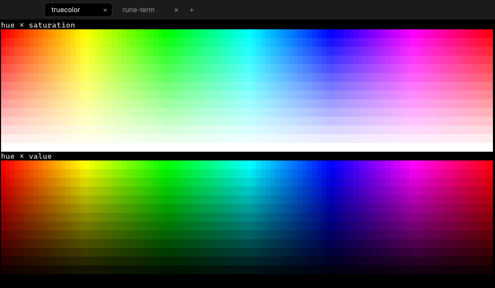

# rune-term

A terminal emulator. Rune owns the window, term-vt the VT and render state, and
the cell grid is a wgpu pass on Rune's device. macOS first; tmux and rmux
sessions are tab groups. The plan is in [`docs/todo/`](./docs/todo/).



More headless captures: [split panes](./docs/images/terminal-split.png),
[search](./docs/images/terminal-search.png), [selection](./docs/images/terminal-selection.png),
[a link's address on hover](./docs/images/terminal-link.png), and
[scrollback](./docs/images/terminal-scrollback.png), and
[multilingual source](./docs/images/terminal-multilingual.png).

Configuration is a directory of TOML files that Cmd+, edits:
[`docs/config.md`](./docs/config.md). `just shots` renders these pictures.


The settings also have dark captures: [General](./docs/images/settings-general-dark.png),
[Profiles](./docs/images/settings-profiles-dark.png),
[theme menu](./docs/images/settings-theme-menu-dark.png),
[theme editor](./docs/images/settings-themes-dark.png) and
[color editing](./docs/images/settings-color-dark.png). The terminal shots above are dark already.
The [site gallery](./docs/shots.md) shows both appearances inline.

## Building

```
cargo run -p rune-term
just check-all
```

One embedded face (Maple Mono NF) and the common CJK fallback are on by
default. Fallback tiers can be added, or removed entirely for a build that
uses only installed fonts:

| Cargo features | Extra fonts | Release size |
| --- | --- | --- |
| default (`font-bundled`, `font-fallback-common`) | common Han, kana, full Hangul | 48.4 MiB |
| `--no-default-features --features font-bundled` | none | 39.9 MiB |
| `+ font-fallback-ja` | JIS X 0208 kanji | ~52 MiB |
| `+ font-fallback-zh-full` | GBK Hanzi | ~61 MiB |
| `+ font-cascadia` | a second selectable face | +2.4 MiB |
| all tiers together | everything above | 65.3 MiB |

A build with no bundled fonts uses any installed font, preferring a monospaced
one, and names the family it chose. With no font at all, it exits with a link
to download one instead of drawing an empty window.

The reusable pieces are on crates.io: `term-font` (font discovery and colour
glyphs), `term-atlas` (the CPU glyph atlas, sprites and fallback) and the
zstd-compressed `term-font-data-*` faces. `term-atlas 0.1.1` can build a face
from bytes or a file path. The rest waits on Rune and Rio releases or on name
collisions; 0.0.1 placeholders hold the names.

The control CLI's generated reference is in [`docs/cli/`](./docs/cli/); `just
docs-cli` regenerates it and the man pages in `man/`.

Dependencies, features and the crates: [`docs/building.md`](./docs/building.md).
The patched Rune and Rio branches it builds against are in
[`docs/todo/status.md`](./docs/todo/status.md).

## Shell integration

A bash or zsh prompt keeps its layout through a resize with OSC 133 marks. In
`~/.bashrc`, after starship:

```
command -v rune-term >/dev/null && eval "$(rune-term shell-integration bash)"
```

zsh, files to source, and where starship gets in the way:
[`docs/shell-integration.md`](./docs/shell-integration.md).

## Roaming sessions

`rune-term-agent` keeps a session on an ssh host alive across a change of
network, as mosh does: [`docs/agent.md`](./docs/agent.md).

## License

MIT. Maple Mono NF (the default face) and Cascadia Code NF (a second selectable
face) are SIL OFL 1.1, shipped zstd-compressed in the `term-font-data-*` crates
and decoded by `term-font` and `term-atlas`.
The fallback subset is a renamed merge of Maple Mono NF CN and NF KR under the same
license, shipped in the same way.
`term-font`'s COLR parser is adapted from Rune (MIT, Copyright 2026 Anomaly).
The terminal host, key encoder, sprites and grid shader come from Rio (MIT,
Copyright 2022-present Raphael Amorim). Each bundled font's notice is in its
data crate's `LICENSE-OFL.txt`; the full third-party notices are in
[`THIRD-PARTY-NOTICES.md`](./THIRD-PARTY-NOTICES.md).
