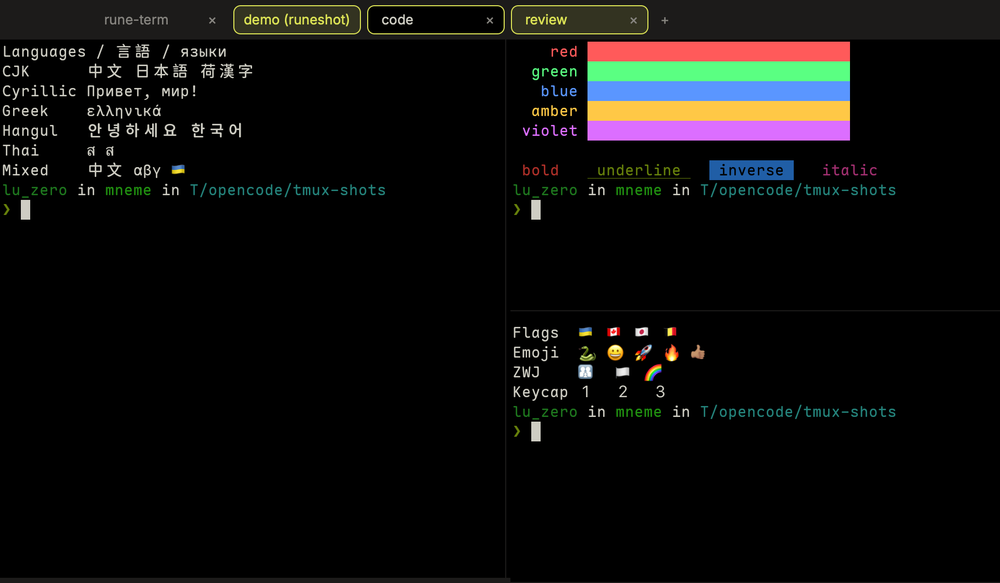
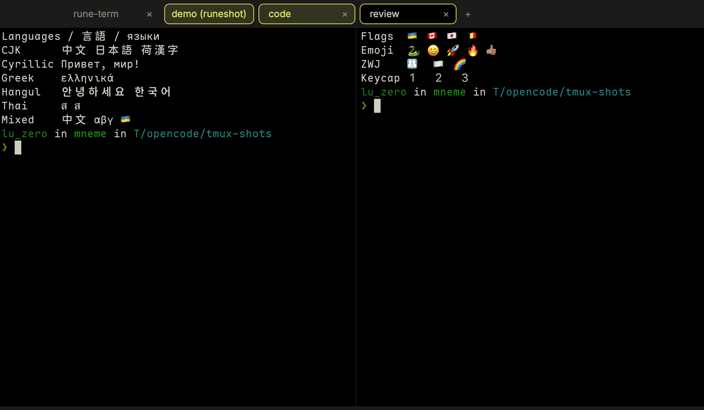

# rune-term

A terminal emulator built on [Rune](https://github.com/anomalyco/rune). [Rune](https://github.com/anomalyco/rune) owns the window, tabs, splits and compositor.
`term-vt` owns the terminal host layer over [Rio](https://github.com/raphamorim/rio)'s VT and grid; `term-grid` draws the cell grid on [Rune](https://github.com/anomalyco/rune)'s device.

## Features

- [Tabs](./docs/images/terminal-tabs.png) and [split panes](./docs/images/terminal-split.png), with whole-cell dividers and per-tab profiles.
- [Search](./docs/images/terminal-search.png), [selection](./docs/images/terminal-selection.png) and [scrollback](./docs/images/terminal-scrollback.png).
- [OSC 8 and plain-URL links](./docs/images/terminal-link.png), with the address shown on hover and Cmd-click to open.
- [Multilingual text](./docs/images/terminal-multilingual.png) using the bundled font fallback tiers.
- A settings window for profiles, themes and app behaviour: [theme editor](./docs/images/settings-themes.png), [General](./docs/images/settings-general-dark.png), [Profiles](./docs/images/settings-profiles-dark.png), [theme menu](./docs/images/settings-theme-menu-dark.png), [themes](./docs/images/settings-themes-dark.png) and [color editing](./docs/images/settings-color-dark.png).
- tmux and rmux sessions as tab groups, with splits inside a session; `rune-term-agent` keeps a session alive across a network change ([docs](./docs/agent.md)).





## Install

The app is not published yet. Build it from source:

```
git clone https://github.com/lu-zero/rune-term.git
cd rune-term
just install
```

This project provides a [justfile](https://github.com/casey/just) to automate installation:

| Command | What it does |
| --- | --- |
| `just install` | Builds and installs `rune-term`, `rune-term-keeper` and `rune-term-ctl` into `~/.local/bin`. |
| `just agent-install` | Installs `rune-term-agent` into `~/.local/bin` for roaming sessions. |
| `just install-shell-integration DIR` | Installs the bash and zsh prompt-mark files into `DIR`. |

## Docs

- [Configuration](./docs/config.md) and [shell integration](./docs/shell-integration.md).
- [Control CLI reference](./docs/cli/) and [headless captures](./docs/shots.md).
- [Crate layout, features and build notes](./docs/building.md).
- [Design and implementation status](./docs/todo/) and [contributing](./CONTRIBUTING.md).

## License

MIT. The bundled fonts are SIL OFL 1.1; code adapted from [Rune](https://github.com/anomalyco/rune) and [Rio](https://github.com/raphamorim/rio) is credited
in [`THIRD-PARTY-NOTICES.md`](./THIRD-PARTY-NOTICES.md).
