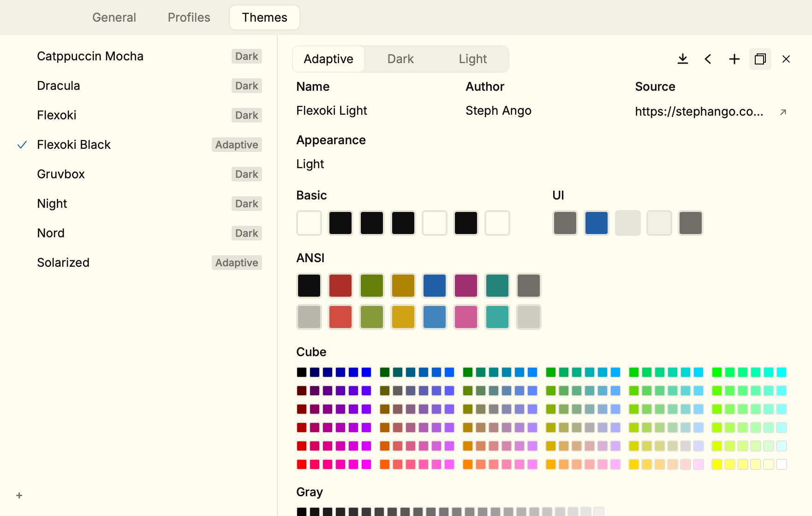

# rune-term

A terminal emulator. Rune owns the window, librio the VT and render state, and
the cell grid is a wgpu pass on Rune's device. macOS first; tmux and rmux
sessions are tab groups. The plan is in [`docs/todo/`](./docs/todo/).


More headless captures: [split panes](./docs/images/terminal-split.png),
[search](./docs/images/terminal-search.png), [selection](./docs/images/terminal-selection.png),
[a link's address on hover](./docs/images/terminal-link.png), and
[scrollback](./docs/images/terminal-scrollback.png).

Configuration is a directory of TOML files that Cmd+, edits:
[`docs/config.md`](./docs/config.md). `just shots` renders these pictures.



## Building

```
cargo run -p rune-term
just check-all
```

Dependencies, features and the crates: [`docs/building.md`](./docs/building.md).
The patched Rune and Rio branches it builds against are in
[`docs/todo/status.md`](./docs/todo/status.md).

## Shell integration

A bash or zsh prompt keeps its layout through a resize with OSC 133 marks. In
`~/.bashrc`, after starship:

```
command -v rune-term >/dev/null && eval "$(rune-term shell-integration bash)"
```

zsh, files to source, and where starship gets in the way:
[`docs/shell-integration.md`](./docs/shell-integration.md).

## Roaming sessions

`rune-term-agent` keeps a session on an ssh host alive across a change of
network, as mosh does: [`docs/agent.md`](./docs/agent.md).

## License

MIT. Cascadia Code NF, vendored in `term-grid/`, is SIL OFL 1.1.
