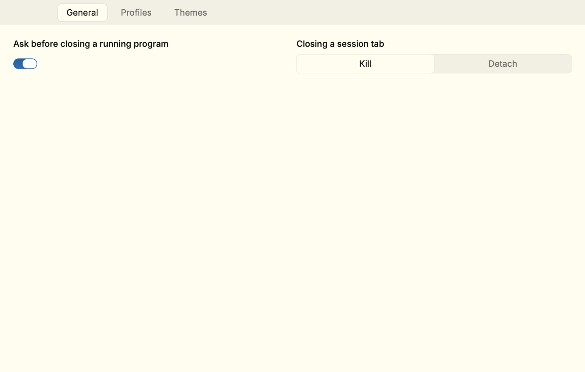
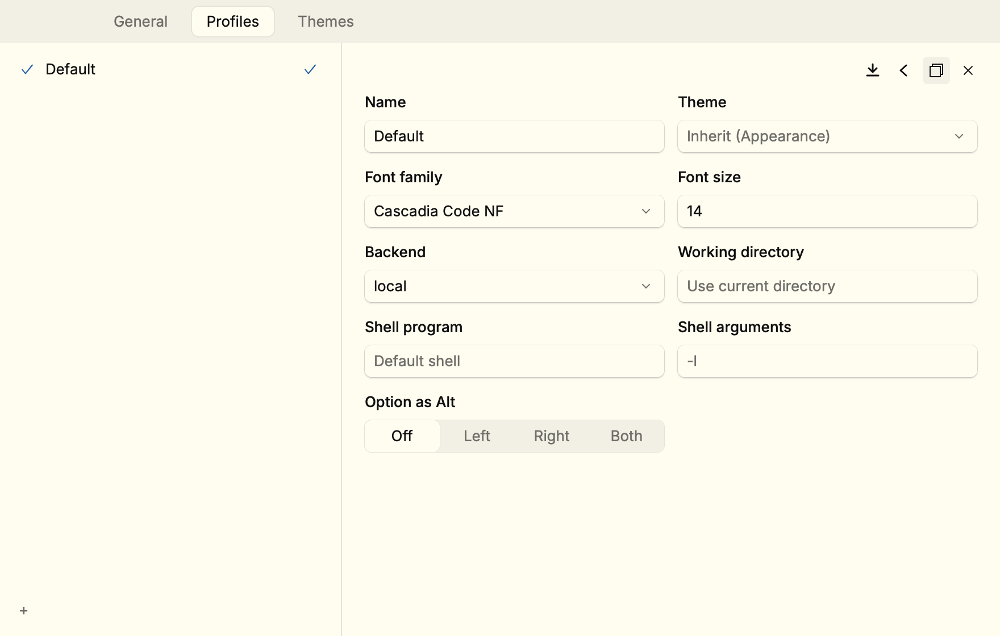
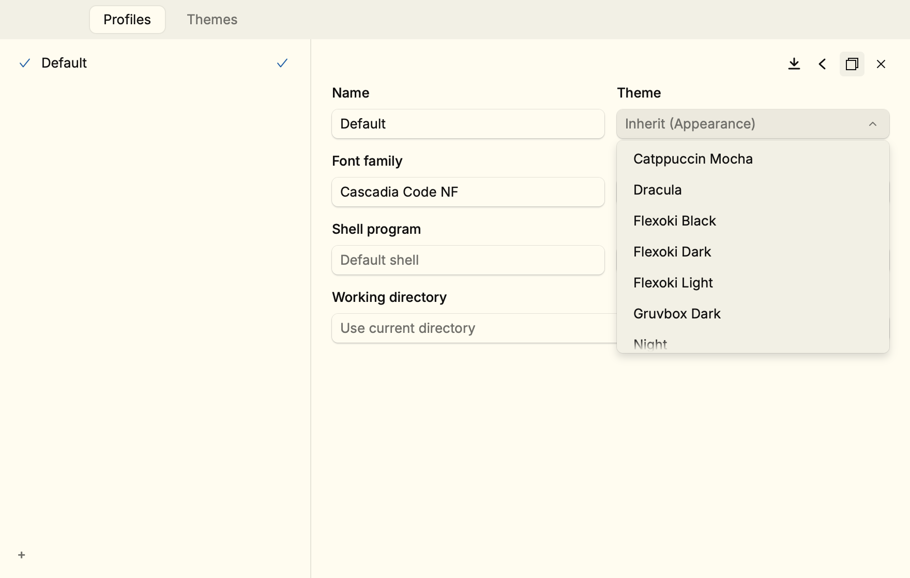
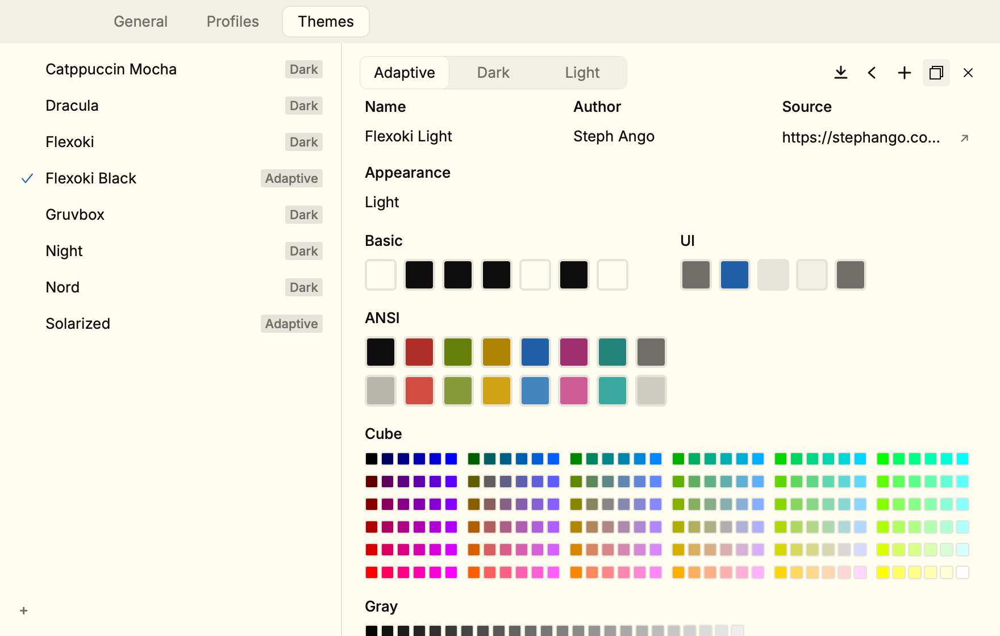
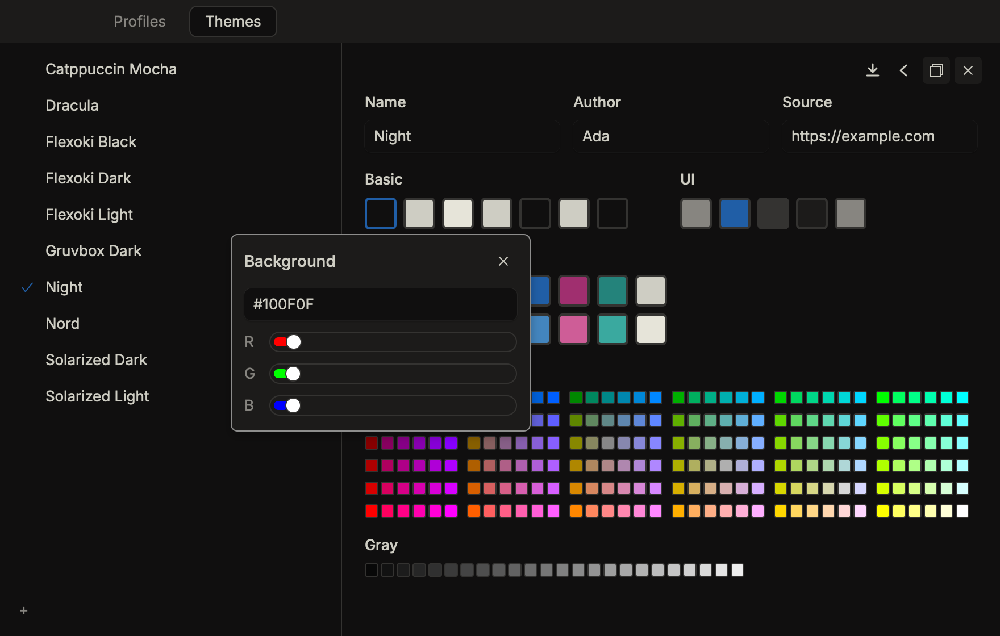

# rune-term configuration

The config is a directory of TOML files. Cmd+, opens a window on the same files. The pictures below are headless renders of [`docs/shots/`](shots/) (`just shots`). The profiles window follows the desktop appearance.

## Location

`$XDG_CONFIG_HOME/rune-term/` (etcetera's XDG directory on every platform). If that directory cannot be resolved, `./rune-term/`.

```
rune-term/
  config.toml
  profiles/<name>.toml
  themes/<name>.toml
```

The file stem is the profile or theme name. A name cannot be empty, `.` or `..`, start with `.`, or contain `/ \ : * ? " < > |` or a control character. Spaces are allowed.

## Behavior

- No `config.toml` and no `profiles/` or `themes/` directory: built-in defaults.
- No `config.toml`, but `profiles/` or `themes/` is present: those files are loaded. A later save writes `config.toml` and does not delete theme files that were read.
- A file that cannot be read or parsed: start on defaults and refuse to save, so the broken file is not overwritten.
- Font sizes are clamped to `6.0..=96.0`.
- `settings.default_profile` falls back to `Default`, then the first profile, when the named profile is missing. A directory with no profile files gains a `Default` profile.

## `config.toml`

```toml
version = 1

[settings]
default_profile = "Default"
font_size = 14.0
theme = "Flexoki Black"

[settings.adaptive_theme]
dark = "Flexoki Black"
light = "Flexoki Light"
```

- `default_profile`: profile used when none is named.
- `font_size`: default size in points.
- `theme`: theme used when a profile does not name one and the appearance pair is not in use.
- `confirm_close`: default `true`. Closing a tab or the window asks first while a program runs in it; a shell at its prompt closes without asking.
- `on_close`: `"kill"`, the default, or `"detach"`. Closing a session tab kills its tmux or rmux window, or detaches it, which hides the tab and leaves the window running. A session profile's `on_close` wins.
- `report_right_click`: default `false`. A right-click opens the pane's menu, as in iTerm2, even while a program such as vim or opencode takes the mouse. With `true` that program gets the click, and Shift+right-click opens the menu.
- `adaptive_theme`: two theme names. When both are non-empty and the profile has no theme, the desktop appearance picks `dark` or `light`. On macOS that is `AppleInterfaceStyle`. Elsewhere, and when the appearance cannot be read, `dark` is used. The pair is not watched while the app is running. Duplicating a theme clears the pair and pins the copy; so does choosing Dark or Light for a paired entry.

`version` is required. Unknown keys are ignored.

## `profiles/<name>.toml`

```toml
font_family = "Cascadia Code NF"
font_size = 14.0
theme = "Nord"
backend = "local"
cwd = "/Users/me/work"

[shell]
program = "/bin/zsh"
args = ["-l"]
```

- `font_family`: default `"Cascadia Code NF"`, which is bundled. The profile editor lists it and the installed monospaced families. Another family draws in its regular face when it is installed, and in the bundled one when it is not. A symbol the face lacks comes from the system's fallback fonts.
- `font_size` (optional): overrides `settings.font_size`.
- `theme` (optional): a theme name. When it is omitted, the profile inherits. With both `adaptive_theme` names set, that is the desktop appearance, and the field reads `Inherit (Appearance)`. Otherwise it is `settings.theme`, and the field reads `Inherit` and that name. A named theme wins over both. The menu lists theme names. Inherit is the empty value.
- `backend`: `"local"`, a shell here, or `"tmux"` or `"rmux"`, a session whose windows are a group of tabs. For a session:
  - `host` (optional): what `ssh` takes; without one the session runs here.
  - `server` (optional): the multiplexer's `-L` name; without one, its default server. Letters, digits, `-`, `_` and `.`.
  - `session` (optional): the session to attach, created when missing; without one each open starts a new session.
  - `transport` (optional): `"ssh"`, the default, or `"agent"`, through rune-term-agent, which roams. See [`agent.md`](agent.md).
  - `on_close` (optional): `"kill"` or `"detach"`, what closing a tab does to its window; without one, `settings.on_close`.
- `cwd` (optional): working directory for sessions created with this profile.
- `option_as_alt` (optional, macOS): `"left"`, `"right"` or `"both"`, the Option keys that send Esc and the key, as Meta, rather than the layout's characters (Option+B as `∫`). Without it, both keys type characters. As in iTerm2, one key can stay for accents.
- `[shell]` (optional): `program` and `args`. When `program` is empty and `args` is empty, the platform shell is used.

## `themes/<name>.toml`

A [WezTerm color scheme file](https://wezterm.org/config/appearance.html#defining-a-color-scheme-in-a-separate-file). `colors.ansi` is required (8 colors). `brights` fills the upper eight and, when omitted, copies `ansi`. Other color keys may be omitted.

```toml
[colors]
foreground = "#CECDC3"
background = "#100F0F"
foreground_bright = "#E6E4D9"
muted = "#878580"
accent = "#205EA6"
cursor_fg = "#100F0F"
cursor_bg = "#CECDC3"
selection_fg = "#100F0F"
selection_bg = "#CECDC3"
split = "#343331"
scrollbar_thumb = "#878580"
ansi = ["#100F0F", "#AF3029", "#66800B", "#AD8301", "#205EA6", "#A02F6F", "#24837B", "#CECDC3"]
brights = ["#6F6E69", "#D14D41", "#879A39", "#D0A215", "#4385BE", "#CE5D97", "#3AA99F", "#E6E4D9"]

[colors.tab_bar]
background = "#1C1B1A"

[colors.indexed]
16 = "#E8BBD0"

[metadata]
name = "Night"
author = "Ada"
origin_url = "https://example.com"
appearance = "dark"
```

Colors are `#RGB`, `#RRGGBB`, `#RRGGBBAA` (alpha ignored), or `rgb()` / `rgba()` including percentages. Unknown keys are ignored, so a pasted WezTerm scheme loads. The name is the file stem. `metadata.name` is written on save and is not read back. `metadata.appearance` is `dark` or `light`; a file without it is classified by its background.

Cursor and selection colors fall back to an inverted foreground and background. `split` and `scrollbar_thumb` fall back to bright black. `tab_bar.background` falls back to the background. `foreground_bright`, `muted`, and `accent` fall back to bright white, bright black, and blue; WezTerm ignores those three keys. Indexes 16–255 in `indexed` replace the xterm cube and gray ramp. A file whose stem is a built-in theme name replaces that built-in until the file is removed.

## Settings window

A field stays in the draft while it is typed and is written when the field is finished: Enter, Tab, or a click elsewhere. Choosing a theme from the menu writes that name immediately. Save writes the whole draft, and so does closing the window. Revert restores the last stored values.

### General



The window opens here. The settings are `confirm_close`, `on_close` and `report_right_click` from `config.toml`, saved as they change.

### Profiles





### Themes



The editor lays a theme out as Name, Author, and Source, then Basic beside UI, then ANSI, Cube, and Gray. ANSI is two rows, the normal colors then the bright colors. The cube is indexes 16–231 and Gray is indexes 232–255, drawn in the xterm colors unless `indexed` replaces one. A narrower window stacks Name, Author, and Source, and stacks Basic and UI. The cube flows by group, six groups on a line where they fit. UI is muted, accent, the split border, the tab strip, and the scrollbar. Hover a swatch for its name. On a theme from `themes/`, click a swatch to edit it as `#RRGGBB` and RGB sliders. A built-in theme does not open the editor. Editing a cube or gray cell stores that index. Setting the cell back to its xterm color, or removing it, drops the override. A dark and a light theme whose names share a base, or that the adaptive pair names, share one list entry with a pill reading Adaptive, Dark or Light. A paired entry has an Adaptive / Dark / Light selector on the left of the editor's action bar. Adaptive makes the window follow the desktop appearance; Dark or Light pins one variant. A single theme offers an Add counterpart action that copies it with the opposite appearance, names the copy `<name> Light` or `<name> Dark`, and sets the adaptive pair. A custom theme's Appearance field changes its metadata, including for a theme in a pair.



## Built-in themes

- `Flexoki Black` (default)
- `Flexoki Dark`
- `Flexoki Light`
- `Dracula`
- `Nord`
- `Solarized Dark`
- `Solarized Light`
- `Gruvbox Dark`
- `Catppuccin Mocha`

Use these names in `settings.theme`, `settings.adaptive_theme`, or a profile's `theme`.
