# Headless captures

`just shots` renders these with Rune's headless tools and no shell. The terminal
shots use the dark theme from `docs/shots/term-config`; the settings shots come
in both appearances.

## Terminal

### Tabs

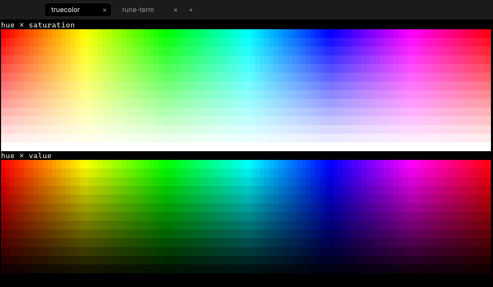

### Split panes

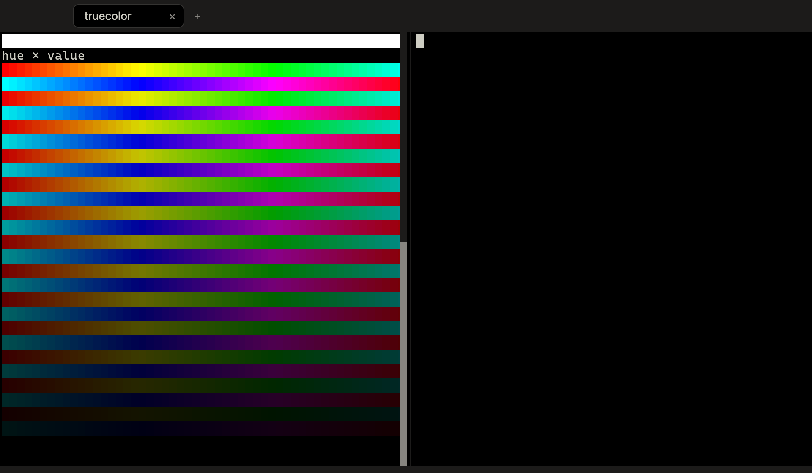

### Search

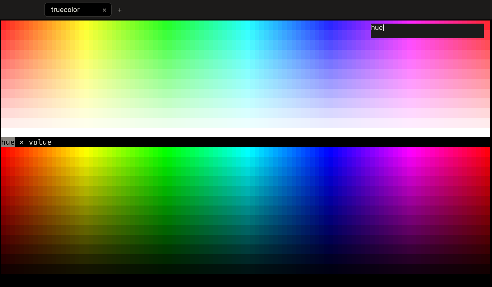

### Selection

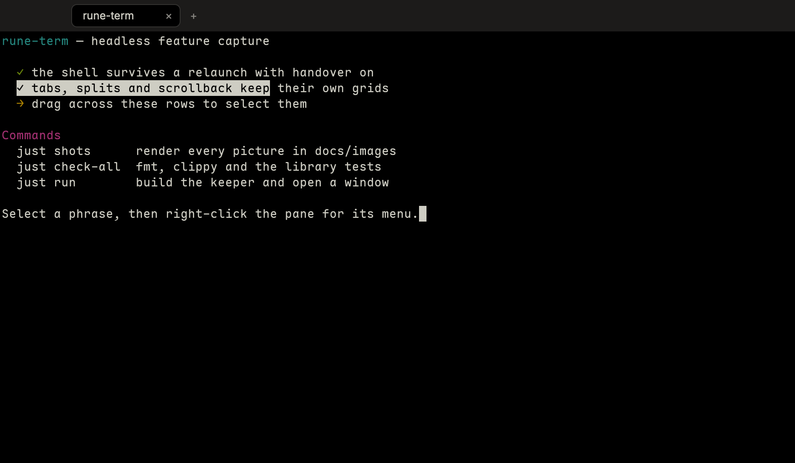

### Link address

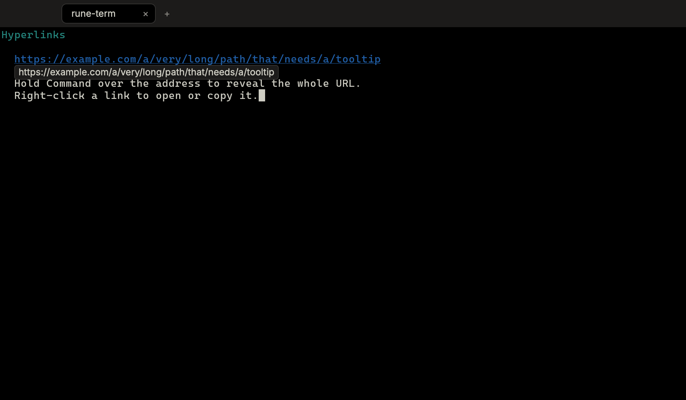

### Scrollback

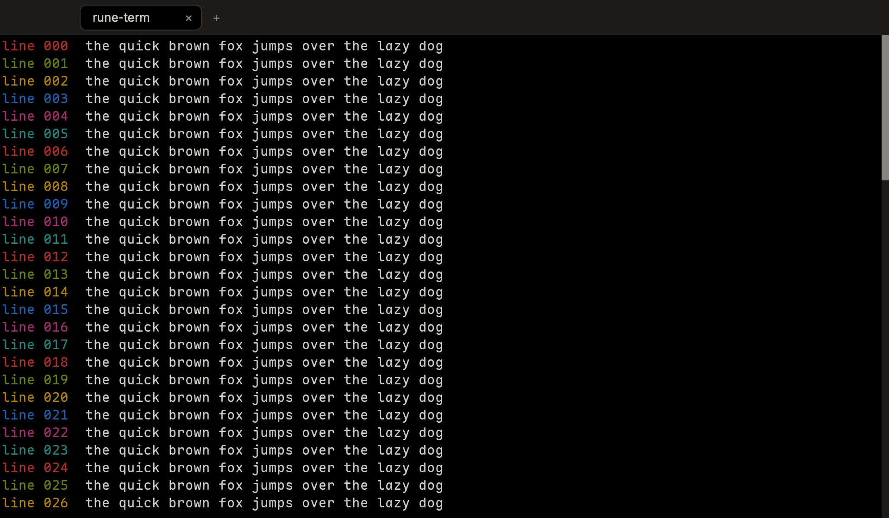

## Settings

### General, light

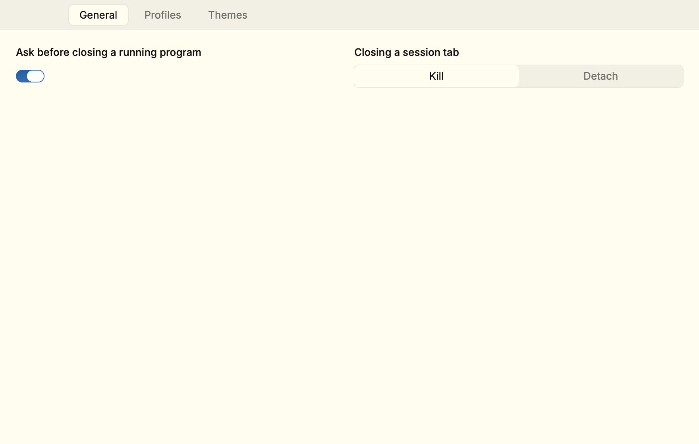

### General, dark

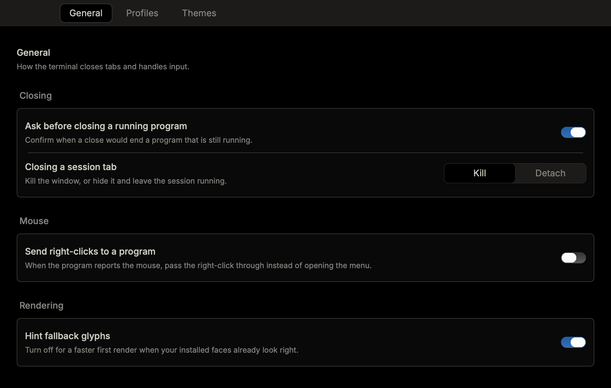

### Profiles, light

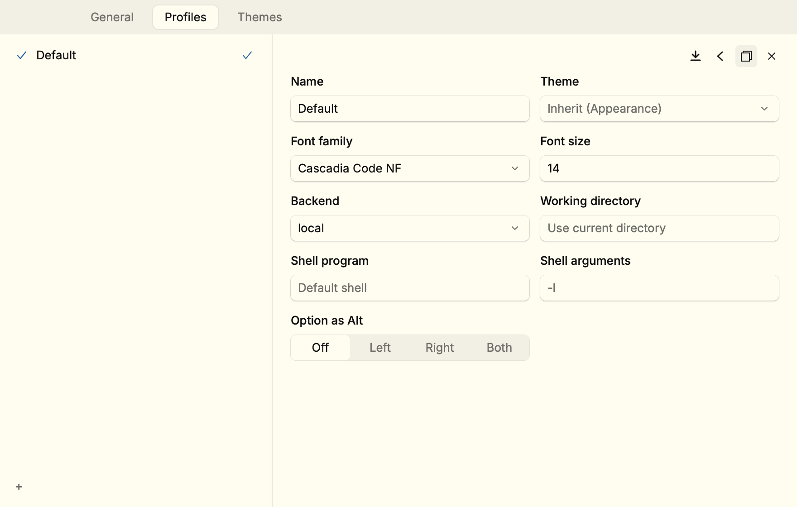

### Profiles, dark

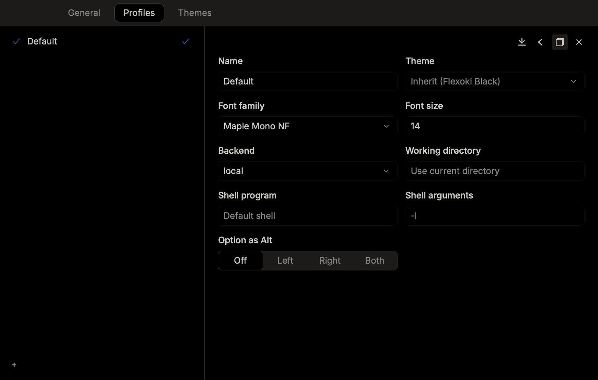

### Theme menu, light

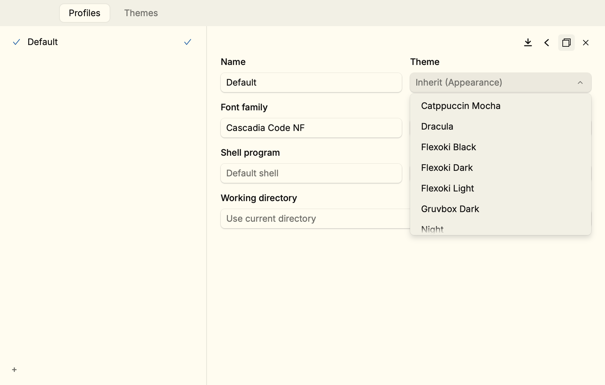

### Theme menu, dark

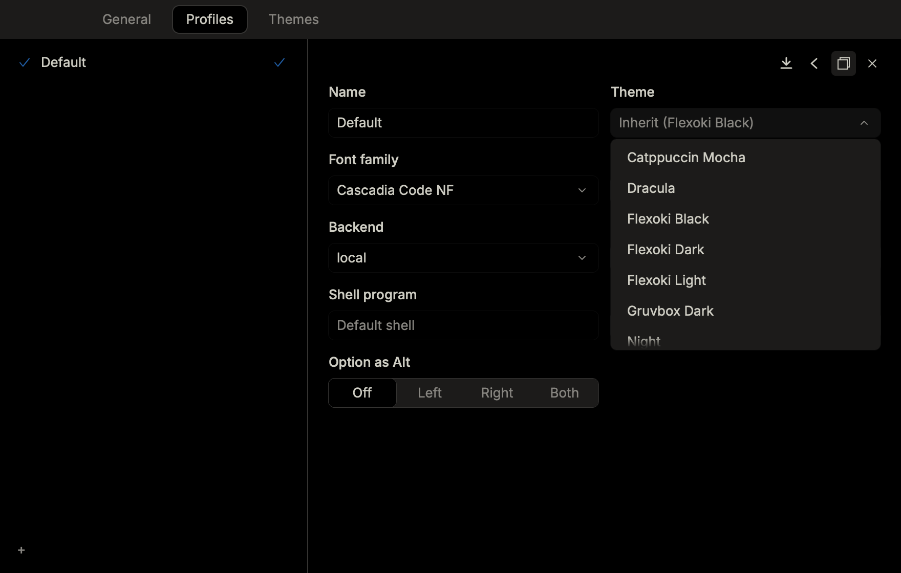

### Theme editor, light

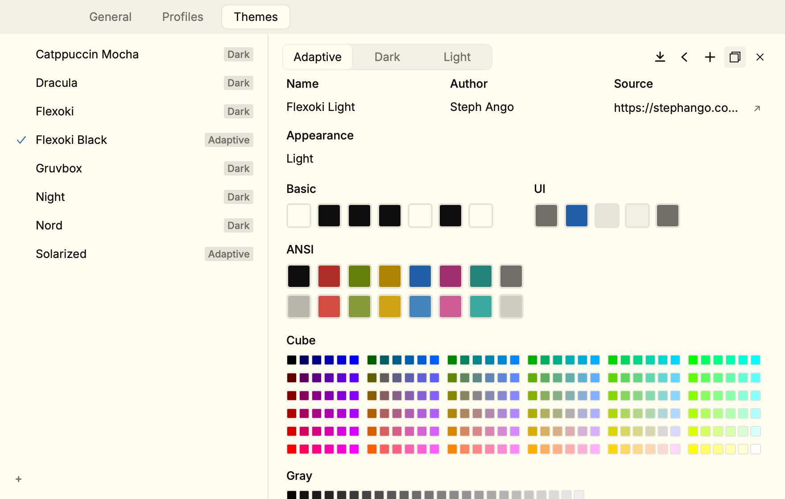

### Theme editor, dark

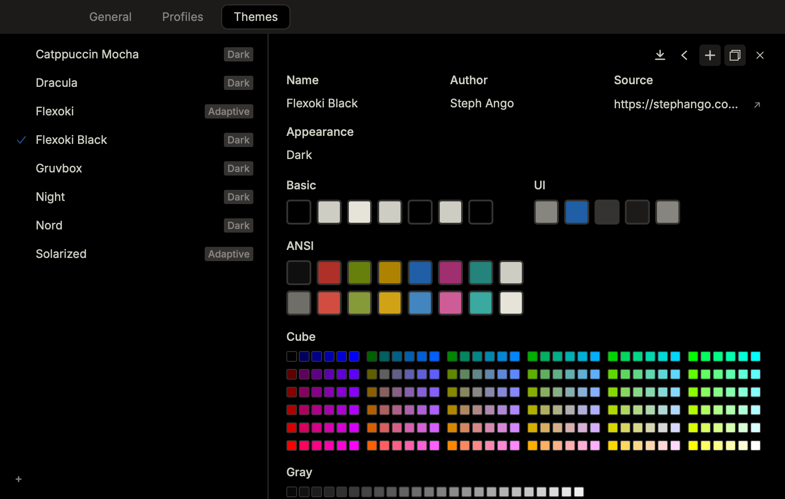

### Color editing, light

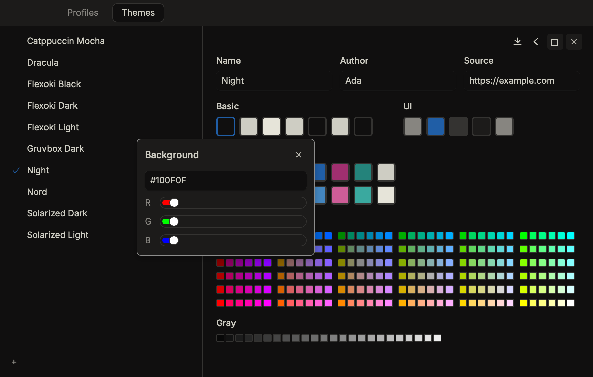

### Color editing, dark

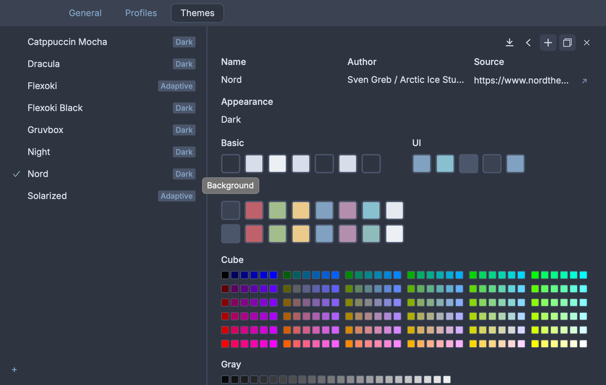
