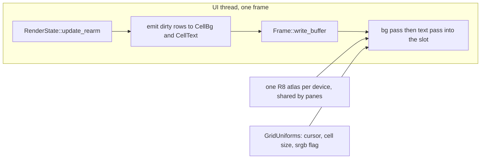
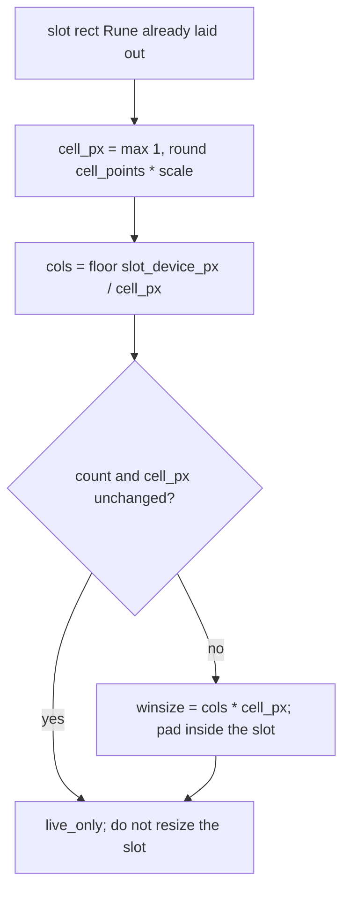
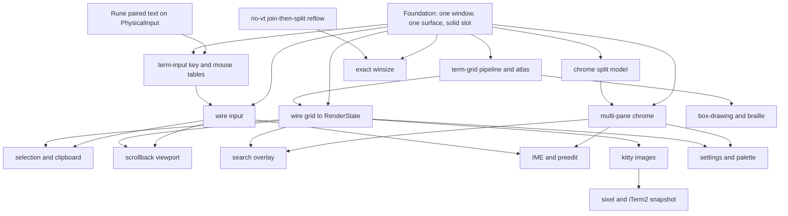

# rune-term: a Rune shell over librio

| | |
|---|---|
| Author | _placeholder_ |
| Date | 2026-11-07 |
| Status | Draft |
| Workspace | `/Users/lu_zero/Sources/rust/rune-term` (empty) |
| Read-only siblings | `/Users/lu_zero/Sources/rust/rune`, `/Users/lu_zero/Sources/rust/rio`, `/Users/lu_zero/Sources/rust/wezterm` |

## Overview

rune-term is a new terminal emulator. Rune owns the window, tabs, splits, focus, clipboard, overlays, and headless PNG snapshots. librio owns the PTY, the VT, and the pull-based `RenderState`. The cell grid is one Rune compositor effect per pane: a wgpu pipeline on the device Rune already created, ported from Sugarloaf's cell layout and aimed at `EffectSite::format` with `Frame::srgb_blend()`. Column reflow is WezTerm's join-then-split, implemented as a tested change inside `rio-vt`'s `Grid::resize`, which is the only function `Surface::resize` calls. rune-term does not carry a second VT, a second GPU device, Sugarloaf, or WezTerm's GUI.

A burst of PTY output wakes Rune once, presents one frame, uploads dirty rows, and leaves the view tree alone. Interactive echo is budgeted at under one present after the bytes arrive on the UI thread, and at most two frames end to end with the shell. `cat` of a large file coalesces to one `RenderState::update_rearm` per presented frame.

## Background & Motivation

Three existing codebases each own a piece that rune-term needs, and each owns other pieces rune-term must not link.

Rune (`crates/rune`) is a retained-ish view shell: `AppSpec::view` rebuilds elements when `poll` returns true, `El::effect(mark)` reserves a compositor slot, and `Compositor::render` paints that slot with `Renderer::draw_with`. The window host's `setup_waker` (`crates/rune/src/window.rs`) is `AppHandle::wake`. A wake redraws a visible window without requiring the view to commit. On macOS the default GPU is Rune's own Metal backend exposed as a wgpu 30 device (`crates/rune/src/gpu/metal/mod.rs`, feature `metal-backend`). Both trees resolve wgpu `30.0.1` (identical lock checksum). The Metal backend panics on binding arrays, depth, MSAA, indirect draws, and more than four color targets. Read-only storage buffers work (`gpu/metal/layout.rs`, `gpu/metal/tests.rs`).

librio (`rio/librio`) is the embedder contract already extracted from Rio: `Engine`, `Surface`, `SurfaceDelegate::wakeup`, `RenderState` (`row_dirty`, `style_at`, `square`, `term_colors`, `kitty_geometry`, `kitty_image_rgba`), `Surface::key` / `mouse_button` / `mouse_motion` / `resize` / `scroll` / `scroll_wheel`, and `librio::key::encode`. `rio-vt` and `teletypewriter` come in through that rlib. librio's README tells Rust callers to depend on `rio-vt` directly, because the crate also exists as a C ABI. The host contract rune-term needs is the `Surface` plus `RenderState` plus the key encoder, which `rio-vt` does not wrap by itself. Rio's own GUI (`rio-window`, `frontends/rioterm`, `rio-backend`, Sugarloaf) stays out of the link.

Rio's grid resize is the Alacritty pairwise shuffle in `rio-vt/src/crosswords/grid/resize.rs` (Apache-2.0 header). It walks wrapped rows and pulls or pushes cells one row at a time. WezTerm joins every soft-wrapped row into one logical line, drops trailing spaces, and splits at the new width (`wezterm/term/src/screen.rs` `rewrap_lines`, `wezterm-surface/src/line/line.rs` `Line::wrap`), and it deletes blank rows below the cursor before they fall into scrollback. That is the behavior to ship. It has to land in `Grid::resize`, because `Surface::resize` (`librio/src/lib.rs`) always calls `Crosswords::resize` (`rio-vt/src/crosswords/mod.rs`), which always calls `grid.resize`. A snapshot rewriter in rune-term would fork a second VT that the next `Surface::resize` would immediately overwrite.

Rio's windowed frontend also reports the wrong PTY pixel size: `frontends/rioterm/src/renderer/utils.rs` `terminal_dimensions` sets `width` and `height` to the content box after margins, remainder pixels included. WezTerm `wezterm-gui/src/termwindow/resize.rs` `apply_dimensions` reports `cols * cell_width` by `rows * cell_height` (issue 535). rune-term follows WezTerm. Splits follow WezTerm's integer-cell tree (`mux/src/tab.rs` `adjust_x_size` / `adjust_y_size`), where a divider costs one cell. Rio's `set_panel_size` (`frontends/rioterm/src/layout/mod.rs`) stores a Taffy `flex_grow` in pixels and lets each pane floor independently.

Sugarloaf's grid (`sugarloaf/src/grid/cell.rs`, `shaders/grid.wgsl`, `grid/webgpu.rs`) is the GPU layout to port. `sugarloaf/src/grid/mod.rs` calls the module scaffolding; the structs, the WGSL, and the wgpu renderer are still the concrete source. Sugarloaf opens its own Metal, Vulkan, or wgpu surface. rune-term does not.

## Goals & Non-Goals

### Goals

- One window, tabs, and integer-cell splits, each leaf a `librio::Surface` and one `El::effect` mark.
- PTY output presents through dirty-row upload. The view function does not run for output, cursor blink, or cursor motion.
- WezTerm join-then-split reflow inside `rio-vt`, with the active alt grid still skipping reflow, image `ReflowRemap` preserved, and a Windows `preserve_scrollback` flag that does not change `Surface::resize`'s four-argument signature.
- PTY winsize in exact cell pixels, `cols * cell_px` by `rows * cell_px`, at most the effect slot. Leftover device pixels are padding inside the slot, outside the reported grid.
- Physical keys mapped onto `librio::KeyEvent` from the platform text and `consumed_mods` Rune pairs onto `PhysicalInput::Key`, app chords returned to Rune, mouse hit-testing in cells, scrollback through `Surface::scroll`.
- Headless inject-and-snapshot tests on Rune's headless GPU.
- Later milestones, specified here so the seams exist: selection and clipboard, scrollback viewport, search overlay, IME preedit drawn by the grid, kitty images from the existing `RenderState` getters, sixel and iTerm2 only after librio grows a placement snapshot, settings and palette, CPU-rasterized box-drawing and braille.

### Non-goals

- SSH domains, a client/server mux, Lua config, serial ports, CRT filters.
- Bidirectional text and HarfBuzz ligatures. Mode 2027 clusters are stored by rio-vt; v1 draws the cluster's primary width and does not shape.
- WezTerm shell integration (OSC 133 and the like), beyond this note: do not parse it in the shell.
- Resize increments. If a later change adds them, the base includes padding and chrome, as `wezterm-gui/src/resize_increment_calculator.rs` `ResizeIncrementCalculator`.
- Linking `sugarloaf`, `rio-window`, `rioterm`, `rio-backend`, `wezterm-gui`, `wezterm` `window`, or `wezterm` `mux`.
- A second wgpu device, a second VT, or reading cell contents from `AppSpec::view`.
- Publishing to crates.io. Rune is pre-release; the dependency is a path.

## Proposed Design

### Crate layout

```
rune-term/                     workspace root
  Cargo.toml                   members = ["term-grid", "term-input", "rune-term"]
  term-grid/                   wgpu pipeline, atlas, dirty-row upload. No rune, no librio.
  term-input/                  PhysicalKeyCode + Mods → KeyEvent, chord predicate, cell hit-test.
  rune-term/                   binary and AppSpec. Path-depends on rune, librio, the two crates above.
```

Path dependencies, relative to each package `Cargo.toml`:

- `rune-term` → `../../rune/crates/rune`, `../../rio/librio`
- `term-input` → `../../rio/librio` with `default-features = false` (key types and `key::encode`; no PTY spawn)
- `term-grid` → `wgpu = { version = "=30.0.1", default-features = false, features = ["wgsl"] }`

`=30.0.1` is required. Rune's lock and Rio's lock both resolve wgpu `30.0.1` with checksum `527ccdf43…`. `Frame::device` is that crate's `wgpu::Device`. A looser requirement can resolve a different 30.0 patch and fail the type check, or pull a second wgpu. When Rune bumps wgpu, term-grid bumps in the same change. term-grid requests no extra `wgpu::Features`. `default-features = false` keeps term-grid from pulling wgpu's hal backends on its own; Cargo still unions features with Rune's `wgpu` dependency (`std`, `parking_lot`, `metal`, `wgsl`, and the `custom` backend on Apple) when the app links both. Rune's Metal backend panics on features it does not implement.

Feature wiring. `--no-default-features` only drops features of the package you named, so librio must not be depended with its own defaults (`pty`, `graphics` in `librio/Cargo.toml`). Those defaults are what make `Surface::new` spawn a login shell when `shell` is `None`.

```toml
# rune-term/Cargo.toml
[dependencies]
rune = { path = "../../rune/crates/rune" }
librio = { path = "../../rio/librio", default-features = false }
term-grid = { path = "../term-grid" }
term-input = { path = "../term-input" }

[features]
default = ["pty"]
pty = ["librio/pty", "librio/graphics"]
graphics = ["librio/graphics"]

# term-input/Cargo.toml
[dependencies]
librio = { path = "../../rio/librio", default-features = false }
```

`cargo test -p rune-term --no-default-features` builds librio without `pty` and is the inject harness. `cargo test -p rune-term --no-default-features --features graphics` is the same harness plus kitty pixel decode, still with no shell. `cargo build -p rune-term` (default `pty`) is the link check. A `cargo test --workspace` that builds rune-term with default features unifies `librio/pty` on for every crate in that invocation; term-input tests must not call `create_surface` in that configuration. Tests that enable `pty` must not call `create_surface` against the login shell.

All three projects are MIT. `rio-vt/src/crosswords/grid/resize.rs` carries an Alacritty Apache-2.0 file header. The reflow patch edits that file in place and does not paste WezTerm source into it. Sugarloaf's `CellBg`, `CellText`, `GridUniforms`, and `grid.wgsl` are Rio MIT and may be ported.

### Process and frame path

```mermaid
sequenceDiagram
  participant PTY as PTY thread (teletypewriter)
  participant VT as rio-vt Crosswords
  participant Del as SurfaceDelegate
  participant Rune as AppHandle::wake
  participant Poll as AppSpec::poll
  participant Comp as Compositor::render

  PTY->>VT: parse until WouldBlock or MAX_LOCKED_READ
  alt grid damage
    VT->>Del: wakeup, inline under the terminal lock
    Del->>Del: frame_flag false→true, no HostEvent
    Del->>Rune: Waker only on that edge
  else title, bell, progress, blink mode, close, clipboard
    VT->>Del: action, close_surface, or clipboard_write
    Del->>Del: enqueue HostEvent, do not touch frame_flag
    Del->>Rune: Waker on every call
  end
  Rune->>Poll: drain the HostEvent queue on the UI thread
  Poll-->>Rune: true only when chrome changed
  Rune->>Comp: draw either way; a false poll does not commit the view
  Comp->>VT: update_rearm (FairMutex; clears frame_flag before unlock)
  Comp->>Comp: upload row_dirty rows, write cursor uniforms
```

`Machine::notify_damage` (`rio-vt/src/performer/mod.rs`) sends at most one `RioEvent::TerminalDamaged` while `Crosswords::damage_event_in_flight` is set. It runs on the PTY reader thread while that thread holds the terminal mutex: `pty_read` keeps the `try_lock_unfair` / `lock_unfair` guard through the `notify_damage` call. `Listener::dispatch` (`librio/src/lib.rs`) invokes `SurfaceDelegate` inline on that same stack. `inject_output` on the UI thread also advances the parser and can call the delegate. The two callers interleave. The delegate must not lock the terminal (the PTY caller already holds it) and must not write `Model`, `Surface`, or the view tree.

`TerminalDamaged`, `Render`, and `RenderRoute` map to `wakeup`. Title, bell, progress, and `CursorBlinkingChange` map to `action` only. A title or bell with no grid damage never enters the wakeup match, so `wakeup` alone cannot refresh chrome. `close_surface` and `clipboard_write` are the same kind of cross-thread call.

The delegate's entire body is two different wakes, matching the diagram. `wakeup` stores that surface's `frame_flag` and calls the `Waker` only when the previous value was false. `action`, `close_surface`, and `clipboard_write` push one `HostEvent` and call the `Waker` on every call. They do not set `frame_flag`. A title or close with no grid damage still reaches `poll`. A title must not look like grid damage: `update_rearm` runs only when that surface's flag or `resized` bit is set, so a chrome event alone does not become a `None` → `Full` upload. `setup` is `fn(&mut S, Waker)`. The waker the window host passes is `AppHandle::wake` (`window.rs` `setup_waker`), which sets `requests.woken` and wakes the event loop. It is not an `AppHandle`. `AppHandle::update` / `update_if` exist (`app.rs`) and would also hop to the UI thread, but setup does not hand the handle over, and the delegate must not block on the UI thread while it sits inside the terminal lock. The queue plus the waker is the contract.

```rust
enum HostEvent {
    Action { id: SurfaceId, action: Action },
    Close(SurfaceId),
    // OSC 52 is denied. The text is dropped on the caller; only the length is queued.
    Clipboard { id: SurfaceId, kind: ClipboardType, len: usize },
}
```

`poll` starts by draining that queue onto `Model` and returns true only when the drained events change chrome the view reads (title, bell, progress, blink mode, closed leaf). A damage-only wake drains an empty queue and returns false. `Runtime::frame` then does not commit the view (`CommitWhy::POLL` is only when poll returns true, `runtime/frame.rs`). The compositor still draws: `a_compositor_s_frame_never_counts_as_unchanged` in `window/tests.rs`. A shown window `request_redraw`s because the drain is not quiet (`window.rs` `drain_frame`). `AppHandle::wake` on a window does not invalidate the view. (`overlay/input.rs` does invalidate; this app is a window, not an overlay.)

Grid damage uses a second flag, cleared under the same lock that consumes the damage. `wakeup` only does `frame_flag.store(true)` and calls the waker when the previous value was false. The compositor calls `RenderState::update_rearm(&frame_flag)`, a new method next to `update` in `librio/src/render_state.rs`. `update()` stays void and unchanged for the C ABI. `update_rearm` is the same body, and after `reset_damage` and `damage_event_in_flight = false`, still holding the `FairMutex` guard, it `frame_flag.store(false, Release)`.

That store has to be inside the lock. The PTY sets the host flag from `notify_damage` while it holds the same mutex, so it cannot run between the clear and the unlock. A wakeup that arrived before `update_rearm` took the lock is the damage this call consumes; leaving the flag true would make the next frame call `update` with `peek_damage_event() == None`, and `render_state.rs` substitutes `TerminalDamage::Full` whenever the snapshot is non-empty. Swapping the flag to false before taking the lock loses that race on every `cat` burst and pays an extra full upload. A wakeup that arrives after the unlock sets the flag again and is a real next frame.

```rust
for host in surfaces.iter_mut() {
    let resized = host.resized.swap(false, Ordering::AcqRel);
    if host.frame_flag.load(Ordering::Acquire) || resized {
        host.render.update_rearm(&host.frame_flag); // clears frame_flag before the guard drops
        upload_dirty(&host.render);
        host.render.reset_dirty();
    }
}
```

Blink ticks and idle frames must not call `update` or `update_rearm`. A `None` peek on a non-empty snapshot is `Full`.

`snapshot_visible` (`crosswords/mod.rs`): `Full`, or a length mismatch, copies every visible row with `dirty = true`. `CursorOnly` and `Noop` return without copying when no grid row is dirty. Cursor fields on `RenderState` (`cursor_line`, `cursor_column`, `cursor_shape`, `cursor_visible`) are written after the snapshot in either case. Cursor motion with clean rows is a uniform update. `cursor_visible` is false for `CursorShape::Hidden`, which covers DECTCEM and a scrolled viewport.

Column and row resize sets `TermDamageState::full = true` (`TermDamageState::resize`). The host resize does not itself `wakeup`. The layout frame that called `Surface::resize` sets `resized` and the same frame's compositor calls `update`. Combined with `full`, the visible viewport uploads. Scrollback is not uploaded.

Synchronized output (DEC 2026): `update` / `update_rearm` return immediately while the hold is active and unexpired, and they still clear `damage_event_in_flight` and, for `update_rearm`, the host flag. The PTY thread stores `sync_deadline` and its poll timeout calls `notify_damage` when the deadline expires or the hold ends (`performer/mod.rs`). With a live PTY that wakeup is the present. The host does not poll `update` to discover the timeout. `inject_output` does not run that thread. A non-pty build has no `sync_deadline` poll, so a BSU without a later ESU stays held until a later `update_rearm` observes `sync_update_expired`. Headless tests do not inject DEC 2026. Sync-update coverage stays in the rio-vt / librio tests that already drive the PTY machine. A harness that must inject a hold calls `update_rearm` once (no copy while held), advances time past the one-second timeout, and calls `update_rearm` again.

### Latency budget

| Path | Budget |
|---|---|
| UI thread, one dirty row (key echo after bytes are already parsed) | < 2 ms upload and uniform write, so it lands in the in-flight or next vsync |
| End-to-end key echo, including the shell | ≤ 2 frames: ≤ 33 ms at 60 Hz, ≤ 17 ms at 120 Hz |
| Full visible upload, 40–80 rows, tens to a few hundred KB | < 3 ms on the UI thread |
| `cat` of a large file | ≤ one `update` and one dirty-row upload per presented frame. View function runs 0 times. Throughput is vsync: 16.7 ms at 60 Hz, 8.3 ms at 120 Hz |
| Column reflow, 120 cols × 10_000 scrollback (~1.2e6 `Square`s) | Linear scan on the UI thread under `FairMutex`. Expected a few milliseconds, not measured. Log a warning above 8 ms. Never on the PTY thread |

`on_physical_input` and mouse handlers that do not change chrome call `Tx::live_only` and return true. `runtime/input/action.rs` skips the view when the handler ran and `live_only` is set (`physical.rs` counts `live_only_skips`). Echo arrives later via PTY wakeup, not via the key handler. A handler that returns false clears `live_only` (`Tx::took`).

`Compositor::animating` stays false. An animating compositor never rests and draws every display frame (`window/tests.rs`). Cursor blink is not that.

### Damage rules

| Event | View commit | `update_rearm` | GPU |
|---|---|---|---|
| PTY bytes, rows dirty | no (`poll` false) | yes | dirty rows of `CellBg` and that row's `CellText` |
| PTY cursor motion, rows clean (`CursorOnly`) | no | yes (the wakeup) | uniforms only |
| Cursor blink phase | no | no | uniforms only (`cursor_pos = u32::MAX` or alpha 0) |
| Column reflow / row-count change | no, unless chrome structure changed | yes, same frame, `resized` | full visible viewport |
| Title, bell, progress, tab list, focus ring | yes (`poll` true or the chord path) | no, unless damage is also pending | unchanged grid |
| Font size | one view commit for the new window point size; the follow-up `on_layout` is `live_only` | yes, on that follow-up, for the fitted cell pixels | uniforms and atlas; rows re-emitted once |
| Plain DPI | no window resize; `live_only` | yes, when the fitted count or the cell pixels change | uniforms and atlas; rows re-emitted once |
| Selection drag | no (`live_only`); `mark_fully_damaged` wakeups | yes | rows the selection touches, tint folded into `CellSample.bg` by the adapter |
| Wheel / Shift+PageUp scrollback | no (`live_only`); `scroll_display` calls `mark_fully_damaged` | yes | full visible viewport |

Blink timer, in `poll`, only while the focused surface's cursor blinks (`Action::CursorBlinkingChange` flips the mode; Rio does not send a wakeup per phase, and `damage_cursor_blink`'s `TerminalDamaged` send is commented out in `crosswords/mod.rs`):

```rust
fn poll(model: &mut Model, _t: f64, tx: &mut Tx) -> bool {
    let chrome = model.drain_host_events(); // UI thread; title, bell, close, blink mode
    if model.blink_due() {
        model.flip_blink_phase();          // compositor reads this; the view does not
        tx.wake_after(Duration::ZERO);      // resting_wake steps one present
        tx.wake_after(BLINK_INTERVAL);      // typically 500ms
    }
    chrome
}
```

`Runtime::resting_wake` (`runtime/motion/timer_wake.rs`) presents when poll returns true, a window frame is requested, or some `wake_after` is `Duration::ZERO`. A non-zero timer whose poll returns false presents nothing (`a_still_compositor_s_window_rests_and_polls_its_timers_first` in `window/tests.rs`). The follow-up frame's poll must not call `wake_after(ZERO)` again. If it does, `Runtime::steps_frames` (`wake_deadlines.first() <= clock` in `timer_wake.rs`) stays true, the window stops resting, and it draws every display frame (`an_animating_compositor_draws_every_frame`). Phase period is one present per edge.

Chrome that `poll` may return true for: OSC title (`Action::SetTitle`), bell (`Action::RingBell`), progress (`Action::Progress`), tab labels, and which pane is focused. Those strings are the only terminal facts the view reads. Cursor column and row may be copied into fields the view does not read, for the grid pass and, while IME is open, the caret element. The view does not call `square`, `style_at`, `text_row`, `cluster_of`, or `kitty_*`.

### Grid pass

One `effect(mark)` per leaf (`el.rs` `fn effect`). `Compositor::render` follows the pattern in `compose.rs`: `f.ui.prepare`, then `f.ui.draw_with`. The hook runs inside the slot's clip and layer. Resources are keyed by `EffectSite::mark` and dropped when a frame does not see the mark. GPU resources are also keyed by `Frame::device_key()`. `f.device` can change; wgpu device ids are not unique across Rune instances (comment on `Frame::render`, hex#982).



Port these layouts from `sugarloaf/src/grid/cell.rs`. Keep them `#[repr(C)]`, `Pod`, and assert the sizes.

- `CellBg` is 4 bytes, `rgba: [u8; 4]`, straight sRGB plus alpha. Do not copy Sugarloaf's "Premultiplied RGBA8" field comment into the Rust struct. `rio-grid` `cell_bg` returns straight RGB plus a separate alpha, and `CellSample` stores the same straight bytes. The fragment premultiplies once, after the `FLAG_LINEAR_BLENDING` branch. Premultiplying on the CPU as well fails the alpha-128 snapshot even with the correct blend factors. Alpha 0 means default background (`CellBg::TRANSPARENT`): the shader leaves the target untouched so Rune's clear and the chrome show through the slot and through leftover padding. The window clear color is the theme background.
- `CellText` is 32 bytes: `glyph_pos [u32; 2]`, `glyph_size [u32; 2]`, `bearings [i16; 2]`, `grid_pos [u16; 2]`, `color [u8; 4]` (straight sRGB plus alpha, same as `CellBg`), `atlas u8` (0 gray, 1 color), `bools u8` (bit 0 no-min-contrast, bit 1 cursor glyph), `page u8`, pad. v1 uses atlas 0, page 0, one glyph per occupied cell. Decorations (underline, strike) are extra `CellText`s, matching Sugarloaf, and can wait until the box-drawing PR if the pipeline PR only emits the base glyph. The instance stride stays 32 either way. The text vertex stage premultiplies `color` once, after the same linear-blend branch.
- `GridUniforms` must be a multiple of 16. The comment "Current layout: 144 bytes" is stale: the scalar block starts at offset 144 (`min_contrast`, `flags`, `padding_extend`, `input_colorspace`) and `size_of` is 160 with that field list. Assert `size_of` is a multiple of 16 after the port, and point the WGSL uniform at the same offsets. Do not trust the 144 figure.

Flag mapping:

- `FLAG_DISPLAY_P3` stays clear. Delete `grid_srgb_to_p3`, `grid_rec2020_to_p3`, and the `input_colorspace` branches inside `grid_prepare_output_rgb` (`sugarloaf/src/grid/shaders/grid.wgsl`). As copied, that function always does sRGB → linear → Display P3 → sRGB, and the `flags` uniform is declared and never read. Leaving the round-trip in place still writes sRGB after the matrices are gone, and a linear frame stays wrong. Rune windows blend like Core Animation in sRGB (`theme.rs`).
- `FLAG_LINEAR_BLENDING` is set from `!site.srgb_blend` (equivalently `!f.srgb_blend()`). The ported fragment shader branches on that bit. Do not branch on `format.is_srgb()`. An isolated layer's `Rgba16Float` target is neither, and holds whichever encoding the frame uses (`EffectSite::srgb_blend`). When the bit is clear (`srgb_blend` true, the default window), write premultiplied sRGB-encoded color. When the bit is set, write linear premultiplied color (the `*Srgb` target encodes on write).
- `grid_bg_fragment` returns `vec4(rgb * a, a)`. It unpacks straight RGBA from the storage word and premultiplies once on that return (`grid.wgsl`). `load_cell_bg` also premultiplies, and the fragment does not call it on the cell path, so the port must not chain the two. The text vertex stage premultiplies `in.color` once. The pipeline blend is src `BlendFactor::One`, dst `BlendFactor::OneMinusSrcAlpha`. Src-alpha blending of that premultiplied result multiplies alpha twice, so any cell with `0 < a < 255` is too transparent. Alpha 0 and 255 hide the bug.
- `input_colorspace` stays in the uniform struct so offsets match, and the shader ignores it.
- `padding_extend` is 0. Leftover pixels are padding, not a stretched last cell.
- `cursor_pos` is `[u32::MAX, u32::MAX]` when the cursor is hidden or in the off phase of blink. Cursor colors go through the same branch as cell colors.

Pipeline subset, matching `sugarloaf/src/grid/webgpu.rs` reduced to what Metal allows:

- Background: one uniform buffer plus one read-only storage buffer of `CellBg`, indexed by `row * cols + col`. Triangle or instanced cell draw. No vertex buffer of per-cell attributes beyond that storage buffer.
- Text: uniform group 0, atlas texture plus sampler group 1, instance buffer of `CellText`.
- One color target. No depth, no MSAA, no bind-group entry with `count: Some` (binding arrays hit `unsupported!` in `gpu/metal/layout.rs`), no indirect, WGSL only (`gpu/metal/shader.rs` rejects other sources).
- Atlas: 2048² `R8Unorm`, `TEXTURE_BINDING | COPY_DST`, one per `DeviceKey`, shared by every pane. Color atlas (`Rgba8Unorm`) waits for the image and sprite PRs.
- Cell buffers: per pane, two copies (`FRAMES_IN_FLIGHT = 2`). `Frame::write_buffer` writes the copy the previous encoder is not still reading. `offset` and length are multiples of 4, which `CellBg` (4) and `CellText` (32) already satisfy. Do not map buffers. Do not allocate a buffer for scrollback.

v1 glyph coverage is one monospace face, one glyph per codepoint. `CellSample::width` comes from `Square::wide()` (`square.rs`): `Wide::Narrow` is 1, `Wide::Wide` is 2 and emits the glyph, `Wide::Spacer` and `Wide::LeadingSpacer` are 0 and emit nothing. Those spacers are the second cell of a wide character, not a separate codepoint. `PLACEHOLDER` (`rio_vt::ansi::kitty_virtual::PLACEHOLDER`, `U+10EEEE`) is also width 0: no glyph, the kitty image owns the cell. `RenderState` does not emit glyphs. The `square.c() != PLACEHOLDER` check in `render_state.rs` only skips virtual-placement runs while scanning text. Skipping `PLACEHOLDER` and then drawing every other codepoint paints the spacer of a wide character and treats image placeholders as text.

Combining-character and mode-2027 cluster tails come from `cluster_of` and are not shaped; the primary cell's glyph is the only quad. The pipeline PR can raster ASCII from a baked 8×16 bitmap. term-grid takes a `FontSource` of gray bitmaps so the library does not depend on swash. The app may use `swash` 0.2 (Rune already does) when wiring the live face.

Color packing follows `rio-grid/src/lib.rs` `cell_bg`, not a glyph emitter inside `RenderState`. The adapter resolves `style_at` against `term_colors()`:

- `ContentTag::BgRgb` / `ContentTag::BgPalette`, or a codepoint whose `style.bg` is not `AnsiColor::Named(NamedColor::Background)`: opaque RGB (`alpha = 255`) from the square or from the palette. Indexed colors go through the palette and `term_colors`, the same inputs `cell_bg` passes to `palette.color` / `palette.compute_bg_color`.
- Default background (`NamedColor::Background`, and the cell is not `StyleFlags::INVERSE`): `[0, 0, 0, 0]`. The grid blend leaves the window clear showing through.
- `INVERSE` swaps fg and bg and the background becomes explicit and opaque, matching `cell_bg`.
- Foreground is the resolved fg, dimmed when `StyleFlags::DIM` is set (rio-grid's dim path scales the RGB before it is stored). Bold and italic select the face, not a second color, and wait until the live face exists. Underline is `CellSample.underline`; the pipeline PR may ignore it, and a later pass emits an extra `CellText` for the decoration the way rio-grid's `emit_underlines` does.
- The bytes stored in `CellSample` are straight sRGB plus alpha. The shader premultiplies. Do not premultiply on the CPU and again in `grid_bg_fragment`.
- Selection and search tints are applied by the rune-term adapter when it builds `CellSample`, by substituting `bg` (and fg, when contrast requires it). `CellSample` does not grow a `selected` bit. rio-grid paints selection in `build_row_bg`, outside `cell_bg`; the adapter does the same substitution before the sample is returned.

term-grid's input is a small trait, not a librio dependency:

```rust
pub struct CellSample {
    pub ch: char,
    pub width: u8,             // 0 spacer, 1, 2
    pub fg: [u8; 4],           // straight sRGB; the shader premultiplies
    pub bg: [u8; 4],           // alpha 0 = default background
    pub underline: bool,
}

pub struct CursorSample {
    pub col: u32,
    pub row: u32,
    pub visible: bool,
    pub color: [f32; 4],
    pub bg: [f32; 4],
}

pub trait GridSource {
    fn columns(&self) -> usize;
    fn lines(&self) -> usize;
    fn row_dirty(&self, line: usize) -> bool;
    fn cell(&self, line: usize, col: usize) -> CellSample;
    fn cursor(&self) -> CursorSample;
    fn reset_dirty(&mut self);
}
```

The app adapter reads `RenderState::row_dirty`, `square`, `Square::wide`, `style_at`, `term_colors`, and the cursor fields. term-grid's own tests are CPU packing plus a `Vec<CellSample>` fixture. They do not link Rune. The draw that has to survive Rune's Metal backend is `rune-term/tests/grid_pipeline.rs`, which already depends on term-grid and calls `rune::render::Gpu::headless`, plus one manual window-device check. Sampling a known gray in both `srgb_blend` modes is part of that test, and so is one pixel with alpha 128, so a src-alpha blend of a premultiplied color fails the snapshot.

Storage, rough, for the GPU, per pane at 120×40. `FRAMES_IN_FLIGHT = 2`, so the cell buffers exist twice (Sugarloaf's wgpu renderer keeps `bg_cpu: [Vec<CellBg>; FRAMES_IN_FLIGHT]` for the same reason). The factor of 2 in the text line below is two quads, not two frames.

- `CellBg`, one copy: 120×40×4 = 19,200 bytes. Two in flight: 38,400 bytes.
- `CellText`, one copy, two quads per cell worst case: 120×40×2×32 = 307,200 bytes. Two in flight: 614,400 bytes.
- Atlas: 2048² bytes ≈ 4 MiB, one per device, not per frame.

A full dirty frame uploads one copy, not both, and not the scrollback.

Box-drawing and braille are a later PR. Copy the CPU raster approach from `sugarloaf/src/sprite/` (`box_drawing`, `braille`, `block`, and the rest) into the gray atlas. Do not link the sugarloaf crate.

### Resize, winsize, and splits



`El::on_layout` reports `[x, y, w, h]` in window points and re-runs the view unless the handler calls `Tx::live_only` (`el/layout_watch.rs`). During a live resize, macOS draws inside `WindowEvent::Resized` before AppKit commits the size (`window/events.rs`). `resize::apply` does not take `Tx` and does not see `Model`. The diagram's `live_only` and `resized` steps are `perform_resize` in `app.rs`, which the foundation freezes and PR 8 does not edit. Policy:

- Cell size in device pixels is `cell_px(cell_points, scale) = max(1, round(cell_points * scale))`. That integer is the raster pitch and the winsize factor.
- The column count is a pure function of the slot Rune already laid out, the scale, and that pitch. `slot_device_px` is `round(slot_points * scale)`, the same rounding as `frame::snap` (`window/frame.rs`). `cols = floor(slot_device_px / cell_px)`, and the same for rows. `Layout` does not write that count back into the slot's point size. An unchanged slot and scale return the same count on the next frame.
- `Surface::resize(cols, rows, pixel_width, pixel_height)` is called with `pixel_width = cols * cell_w_px` and `pixel_height = rows * cell_h_px`, saturated at `u16::MAX`. librio forwards those two pixel fields straight into `Msg::Resize(WindowSize { width, height, .. })` (`librio/src/lib.rs` `Surface::resize`). Both products are at most the effect slot. Remainder pixels are padding inside the slot, not a second column.
- The same cols and rows with a different cell pixel size still calls `Surface::resize`. `Crosswords::resize` treats equal grid dimensions as a graphics-metrics update and rescales kitty placements, then returns (`crosswords/mod.rs`, the `dimensions unchanged` branch). The host still sets `resized` so one `update` runs.
- Equal count and equal cell pixels: do not call `Surface::resize`. `on_layout` calls `live_only`. A count change also calls `live_only`. The slot rect is already the one the window laid out, so the view does not commit a new point size for it.
- Do not assign the content slot `cols * cell_points` after the floor. That write is the shrink loop: an 1184 px slot floors to 78, `78 * 7.4` points is 1154.4 px, and the next floor is 76.
- `grid_padding` is `(top, right, bottom, left) = (0, slot_device_w - cols * cell_w_px, slot_device_h - rows * cell_h_px, 0)`. Both gaps are >= 0 whenever the slot holds at least one cell. `padding_extend` stays 0. A slot shorter than one cell reports one column or row; that is the only case where the product can exceed the slot.
- Font-size change is `ResizeRequest::Font`, and it takes `scale`. It keeps the requested cols and rows by returning a window whose content size snaps to at least `cols * cell_px` by `rows * cell_px` device pixels: `content_points` below, plus chrome. `cols * cell_points` is not large enough when `round` goes up (`80 * 7.4` points at scale 2 is 1184 px, and 80 columns of 15 px need 1200). `resize_surface` is false on this call. `live_only` is false so the divider, which is one cell thick, picks up the new point size. The follow-up `Layout` of the snapped slot is the call that resizes the PTY, and it is `live_only`.
- Plain DPI change is not a window resize. Rune's `ScaleFactorChanged` path keeps the logical size (`window/frame.rs` `rescaled`). `window_points` stays `None`. The count is the floor of the new device slot, so it stays when that floor still equals the old count and changes when the new budget does not hold it. The following frame, with the same slot and scale, returns that same count. Do not call `resize_window_instant`.
- A DPI change that arrives together with a new window frame (the window was tiled or moved across displays and the point size changed) is a user resize. The floor runs on the new slot. The count may change.

```rust
/// Rounded cell pitch. Raster size and winsize factor.
pub fn cell_px(cell_points: f32, scale: f32) -> u16 {
    let px = (cell_points * scale).round();
    if !px.is_finite() || px < 1.0 {
        1
    } else if px > u16::MAX as f32 {
        u16::MAX
    } else {
        px as u16
    }
}

/// Device pixels of a slot edge. Matches `frame::snap`: `(points * scale).round()`.
pub fn slot_device_px(slot_points: f32, scale: f32) -> u32 {
    let px = (slot_points * scale).round();
    if !px.is_finite() || px <= 0.0 {
        0
    } else if px >= u32::MAX as f32 {
        u32::MAX
    } else {
        px as u32
    }
}

/// How many cells fit. `count * cell_px <= slot_device_px` when the slot
/// holds at least one cell. A shorter slot returns 1.
pub fn fitted_cells(slot_points: f32, scale: f32, cell_points: f32) -> u16 {
    let pitch = u32::from(cell_px(cell_points, scale));
    let device = slot_device_px(slot_points, scale);
    let mut n = device / pitch;
    if n == 0 {
        n = 1;
    }
    if n > u32::from(u16::MAX) {
        n = u32::from(u16::MAX);
    }
    // Keep cols * cell_px inside u16::MAX as well as inside the slot.
    while n > 1 && n.saturating_mul(pitch) > u32::from(u16::MAX) {
        n -= 1;
    }
    n as u16
}

/// Point size whose snapped device size is `cols * cell_px`.
/// This is the content size a request uses when it wants that many columns.
pub fn content_points(cols: u16, cell_points: f32, scale: f32) -> f32 {
    let pitch = f32::from(cell_px(cell_points, scale));
    (f32::from(cols) * pitch) / scale
}
```

At cell width 7.4 points and scale 2, `cell_px` is `round(14.8) = 15`. A slot of `80 * 7.4 = 592` points is `round(1184) = 1184` device pixels. `floor(1184 / 15) = 78`, the winsize width is `78 * 15 = 1170`, and the right pad is `1184 - 1170 = 14`. That slot must not report 80 columns or a width of 1200: column 79 would sit at device pixels `[1185, 1200)`, past the slot clip, and the effect hook draws inside the slot. The same inputs on the next frame are 78 again. Writing the slot back as `78 * 7.4` points would make the next floor 76; `Layout` does not do that. A request that wants 80 columns uses `content_points(80, 7.4, 2) = 600` points, which snaps to 1200 device pixels, floors to 80, and floors to 80 again. The 1005×710 test at scale 1 with a 10×20 cell still reports `100 * 10` by `35 * 20`, with 5 px and 10 px of padding.
- Live drag reflows as soon as the floored column or row count changes. It does not defer `SIGWINCH`. In WezTerm, `live_resizing && dpi unchanged` only skips `scaling_changed` and still calls `apply_dimensions` (`termwindow/resize.rs`).
- Resize increments are out of scope.

`Crosswords::resize` early-outs before `damage.full` when only cell pixels change. The explicit `resized` flag covers that. When the grid size does change, `TermDamageState::resize` sets `full`, so the following `update` recopies the viewport.

#### Splits

Store the tree in integer cells, not in Taffy grow factors.

```rust
enum Axis { Horizontal, Vertical } // Horizontal = left | right, as in mux/src/tab.rs

struct Leaf {
    surface: SurfaceId,
    mark: u32,
    cols: u16,
    rows: u16,
}

enum Node {
    Leaf(Leaf),
    Split { axis: Axis, left: Box<Node>, right: Box<Node> },
}
```

`distribute(total_cols, total_rows, tree)` is a pure function. A divider costs one cell on the split axis (`compute_min_size` in `mux/src/tab.rs` adds 1). No leaf goes below 1. Extra cells are handed out one at a time, left or top first, matching `adjust_x_size` / `adjust_y_size`:

- A split parallel to the axis (Horizontal while adjusting columns, Vertical while adjusting rows) gives one cell to the left/top child, then one to the right/bottom, and repeats. Shrinking takes from the left/top first, and refuses to take the last cell.
- A split perpendicular to the axis applies the whole delta to both children and keeps them the same size along that axis.
- A new split of N cells: the divider consumes 1, the left/top child gets `(N - 1).div_ceil(2)`, the other child gets the rest. Both at least 1, so N ≥ 3 is required to split; smaller grids refuse the split.

Rune lays chrome (tab strip, divider) out with normal elements. The parent rect is the one the window already assigned. A leaf's device size is its integer share times `cell_px`, converted back to points with `frame::snap`, so the next `floor(device / cell_px)` returns that share. It is not `share * cell_points`, and a measurement does not shrink the leaf and measure again. The divider is one `cell_px` wide. Padding is the parent's leftover device pixels, inside the parent, after the shares. Panes do not use `.grow()`. Rio's `set_panel_size` (`flex_grow = pixel size`, `flex_basis = 0`) is the approach this replaces: independent per-pane floor drops or duplicates columns.

#### Reflow, in rio-vt

Owner of reflow today:

`Surface::resize` → `Crosswords::resize` (`crosswords/mod.rs`, `pub fn resize`) → `self.grid.resize(!is_alt, num_lines, num_cols)` and `self.inactive_grid.resize(is_alt, …)` → `Grid::resize` in `rio-vt/src/crosswords/grid/resize.rs`.

When the primary grid is active, `is_alt` is false, so the active grid reflows and the alt grid does not. When the alt screen is active, the visible alt grid is called with `reflow = false`, and the inactive primary is called with `reflow = true` so swap-back has the right width. That split stays. "Alt screen does not reflow" means the grid the user is looking at while alt mode is on. It does not mean the hidden primary is frozen.

`Grid::resize(reflow, lines, columns)` currently grows or shrinks lines first (`grow_lines` pulls from history, bottom gravity; `shrink_lines` keeps the cursor on screen by pushing rows into history), then `grow_columns` / `shrink_columns` do the pairwise wrap shuffle. `should_reflow` is "last cell has `wrapline()` and the row is shorter than the new width" on grow, and the symmetric push on shrink. There is no join of a whole logical line, no trailing-space drop, no column-0 cursor rule, and no deletion of blank rows below the cursor before they enter scrollback. `Crosswords::resize` has no ConPTY flag. Windows PTY creation in `teletypewriter/src/windows/conpty.rs` is ConPTY.

The patch replaces the column half of `Grid::resize` when `reflow` is true. `reflow = false` keeps a clip or pad of each row and does not join. Implement the algorithm against `Row` and `Square`. Do not copy `wezterm` source into the Apache-2.0 file.

1. If `reflow` and the column count changes, pop trailing whitespace rows strictly below the cursor, stopping at the first non-whitespace row. Only `cursor_row + 1 .. len`, only a whitespace tail. Interior blank rows stay. This runs before those rows can be pushed into scrollback, so maximize then restore does not grow history. WezTerm does this in `Screen::resize` before `rewrap_lines`.
2. Join consecutive rows whose last square has `CellFlags::WRAPLINE` (`Square::wrapline`, `square.rs`) into one logical line. Clear the flag on the joined line.
3. Drop trailing spaces the way `Line::wrap` does (`rposition` of a cell whose visible text is not a space), then split into rows of the new width. Every fragment except the last gets `WRAPLINE` on its last cell. Wide squares (`Wide`) must not be cut in half; the existing wide-char remap tests (`grid/tests.rs` `shrink_reflow_remap_tracks_displaced_wide_char`, `grow_reflow_remap_tracks_unmerged_wide_char`) have to pass or be rewritten to describe the new wrapping of the same fixture, not deleted to go green.
4. The cursor is an index into that logical line: `x + prior_len` while joining, then `index / cols`, `index % cols`. If the column lands on 0 and the row is greater than 0: when shrinking, keep the original cursor column on the previous row (the cursor may sit past the new width); when growing, set the column to the new width on the previous row and decrement the row. This is `rewrap_lines` in `wezterm/term/src/screen.rs`. It runs even when the line was not soft-wrapped: a cursor already sitting in column 0 has `index % cols == 0`, so the special case moves it. That is the rule. It replaces the Alacritty `should_wrap` / `cursor.pos.col += 1` adjustment in `grow_columns`, including on the unwrapped grid. Do not keep that adjustment beside the new rule.
5. If the wrapped result is taller than `screen_lines + scrollback`, pop trailing whitespace again, as `rewrap_lines` does before giving up and dropping real lines off the top.
6. Vertical size: bottom gravity stays for the default flag (`grow_lines` pulls history and moves the cursor down). `shrink_lines` may keep its "cursor stays on screen" scroll into history after the blank-tail prune.
7. `preserve_scrollback` is a `bool` argument on `Grid::resize`, not a fixup after it returns. `Crosswords` stores the flag (default false) and passes it into both `grid.resize` and `inactive_grid.resize`. `grow_lines` reads it: when true, append blank rows to the bottom of the visible region and do not pull history or subtract `from_history` from `display_offset`. Applying the pad after `grid.resize` has returned is too late; `grow_lines` has already moved the ring. This matches WezTerm `resize_preserves_scrollback = is_conpty`. Plumb the setter as `Surface::set_resize_preserves_scrollback(bool)`. Do not add a parameter to `Surface::resize(cols, rows, pixel_width, pixel_height)`; that signature is the C ABI. The macOS app leaves the flag false. A Windows host sets it true. The flag is not a macOS milestone blocker.
8. When `track_reflow_remap` is set, fill `ReflowRemap` (`grid/mod.rs`): `base_abs` is `lines_evicted()` at the start, `new_pos[old_oldest_first]` is the oldest-first position where that row's first cell landed, or `-1` if the row was dropped. `Crosswords::resize` already takes the remap and rewrites `dest_row` / `abs_row` through `remap_abs`. Kitty placements on a dropped row stay put; sixel and iTerm2 placements on a dropped or truncated row are destroyed. The new joiner must still produce this map. Rows that join into one logical line each record the new position of their own first cell, which may now share a destination row or land several rows away. Vertical-only resizes still produce no remap (`Crosswords::resize` only asks when placements exist, and a pure line-count change does not move absolute rows).
9. Selection is already cleared on a column change in `Crosswords::resize`. Leave that.

Order when `reflow` is true: prune the blank tail, rewrap columns, then apply the line-count change. The current function adjusts lines first. Tests that encode pairwise cursor positions are expected to change; replace them with join-then-split cases rather than preserving the shuffle.

There is no pad-or-clip fast path. Rio's current short circuit (no row has `WRAPLINE`, and `track_reflow_remap` is false) keeps cells that `Line::wrap` would drop and skips the column-0 rule. Shrinking `"hello   "` from width 8 to 6 must yield `"hello"`, because `Line::wrap` truncates at the last non-space when `line.len() > physical_cols`. A cursor in column 0 on an unwrapped row still takes the column-0 branch. Both are required tests. Scanning the ring for the join is the reflow the latency budget already allows. When `track_reflow_remap` is set, the slow path builds `ReflowRemap`; there is no second map builder.

rune-term's only call is `Surface::resize` with the exact winsize. It does not reimplement reflow.

### Input

`PhysicalInput` (`crates/rune/src/input/physical_input.rs`):

```rust
pub enum PhysicalInput {
    Key {
        key: PhysicalKeyCode,
        mods: Mods,
        pressed: bool,
        repeat: bool,
        /// Platform text already paired with this physical key.
        /// `None` when the key produces no text.
        text: Option<String>,
        /// Modifiers the platform spent producing `text`.
        consumed_mods: Mods,
    },
    Modifiers(Mods),
    FocusLost,
}
```

`PhysicalInput` is `Copy` today. `text: Option<String>` removes `Copy` (`Clone` stays). `Drop` zeroizes `text` the way `Key::Text` does in `edit/keys.rs`. Every in-tree `PhysicalInput::Key` literal names the two new fields. A caller with no platform string passes `text: None` and `consumed_mods: Mods::default()`. `tooling.rs` `canvas_input` clones the scripted event instead of copying it.

`PhysicalKeyCode` is `winit::keyboard::KeyCode` (`shortcuts/keys.rs`). `El::on_physical_input` runs before logical editing, app shortcuts, and focus navigation, and only on the focused element (`runtime/input/physical.rs` `offer_physical`). The pane is `.focusable(true)`. A search field or other text input, once focused, takes the keys; the pane stops seeing them. That is what we want for the search overlay.

`physical_with_fallback` and `physical_then` already queue a logical `KeyEvent` beside the physical event. `offer_physical` forwards only `&PhysicalInput`, so the handler never sees that string today. `physical_then` copies `Key::Text` into `text` when the field is still `None`, before the event is queued. `offer_physical` then hands the handler an event that includes the paired string. If the handler returns false, `route_key` still sees the logical key. Returning true consumes the key and skips shortcuts, paste, and `AppSpec::on_key`. The test `physical_dispatch_precedes_modal_app_and_paste_after_same_frame_click` is the proof that a consuming handler blocks paste.

`librio::key::encode` (`librio/src/key.rs`) prefers `KeyEvent::text` for `Key::Char` (`plain_char_uses_platform_text`). Without text it emits the unshifted character. `KeyEvent::key` is defined as unshifted: shift+a is `Char('a')` and `"A"` lives in `text`. `Modifiers::SUPER` makes `encode` return `None`, so `Surface::key` returns false and Command chords are not written to the shell. `composing` returns `None`. A text-only event (`key: None`, `text: Some`) passes the bytes through (`text_only_events_pass_text_through`), which is the IME commit path later.

`encode_legacy` reads that platform string. A private US-QWERTY table in `term-input` would mis-encode other layouts and dead keys. `shortcuts::keys::us_char` stays `pub(crate)` inside Rune and is not a text source for the pane. `map_key` copies `text` and `consumed_mods` onto `librio::KeyEvent` and calls `encode`. It does not synthesize a US-QWERTY string.

`Mods` (`edit/keys.rs`): `shift`, `alt`, `ctrl`, and `logo` are keys. `cmd` is the primary shortcut modifier: ⌘ on macOS (reported with `logo`) and Ctrl elsewhere (reported with `ctrl`). Off macOS, Ctrl+C is `{ cmd, ctrl }`. Mapping `cmd` to `librio::Modifiers::CTRL` would be wrong on macOS, and treating every `mods.cmd` as an app chord would swallow Ctrl+C off macOS.

Modifier mapping onto `librio::Modifiers`:

| Rune `Mods` | `librio::Modifiers` |
|---|---|
| `shift` | `SHIFT` |
| `ctrl` | `CTRL` |
| `alt` | `ALT` |
| `logo` | `SUPER` |

`consumed_mods` is a `Mods` value, the modifiers the platform already spent producing `text`. `map_key` translates it with the same table (`shift` → `SHIFT`, `alt` → `ALT`, `ctrl` → `CTRL`, `logo` → `SUPER`) and does not translate `cmd`.

The window path fills both fields. `window/events.rs` `KeyboardInput` already calls `physical_then` with the logical key from `map_key_event` and `key_base`. It sets `text` from winit `KeyEvent::text` and sets `consumed_mods` by comparing that string with `key_without_modifiers` (the same method `window/keys.rs` `key_base` uses):

- Alt is consumed when it is held and the platform text differs from the unmodified key. Nordic Alt+8 produces `[`. macOS Option+d produces `∂`. `encode` emits that text. An unconsumed alt, with `alt_is_meta` still true, would ESC-prefix instead (`consumed_alt_is_not_meta` in `librio/src/key.rs`).
- Shift is consumed when it is held, Ctrl is not, and the platform text differs from the unmodified key. shift+a produces `A`.
- Ctrl stays unconsumed on a control chord. `encode_legacy` applies `ctrl_byte` itself and ignores `text` while Ctrl remains. `text_with_all_modifiers` (`Ctrl+a` → `"\x01"`) is not the string stored in `text`.
- On Windows, Left Ctrl+Left Alt that `map_key` (`window/keys.rs`) already classifies as `Key::Text` is AltGr. Both `ctrl` and `alt` are consumed, so the character is written and is not also a control sequence.
- `logo` is never consumed. App chords still read `mods.logo` and `mods.cmd`.

`physical_then` does not invent `consumed_mods`. Hosts other than the window pass the field they know, or leave it empty. The scripted path gets its `text` from the paired `Key::Text`.

Representative `PhysicalKeyCode` → `librio::Key`. This is the key identity `ctrl_byte` and the CSI forms use. `text` and `consumed_mods` are copied from the event and are not looked up in this table.

| Physical key | `Key` |
|---|---|
| `KeyA` … `KeyZ` | `Char('a'..'z')` |
| `Digit1` … `Digit0` | `Char('1'..'0')` |
| `Minus`, `Equal`, brackets, quote, comma, dot, slash, backquote, backslash, semicolon | the unshifted `Char` of that physical key |
| `Space` | `Char(' ')` |
| `Enter`, `Tab`, `Backspace`, `Escape` | `Enter`, `Tab`, `Backspace`, `Escape` |
| `Arrow*` | `Up` `Down` `Left` `Right` |
| `Home` `End` `PageUp` `PageDown` `Insert` `Delete` | the matching variant |
| `F1` … `F24` | `F(n)` |
| `ShiftLeft` / `ShiftRight`, `ControlLeft` / `ControlRight`, `AltLeft` / `AltRight`, `SuperLeft` / `SuperRight`, `CapsLock` | the matching modifier key |
| `Numpad0` … `Numpad9` | `Char('0'..'9')` |
| `NumpadDecimal` | `Char('.')` |
| `NumpadAdd`, `NumpadSubtract`, `NumpadMultiply`, `NumpadDivide` | `Char('+')`, `Char('-')`, `Char('*')`, `Char('/')` |
| `NumpadEnter` | `Enter` |

Numpad keys stay printable because their platform `text` is copied through. A numpad event with `text: Some("5")` encodes `"5"`. `map_key` returns a real `Key` for every row above. An unknown `PhysicalKeyCode` with `text: None` returns `key: None` and empty text, and the pane handler returns false without calling `Surface::key`, so focus traversal can take it. An unknown code whose `text` is one scalar uses `Key::Char` of that scalar plus the string. An unknown code whose `text` is longer (an uncombined dead key) uses `key: None` and `text: Some`, which `encode` passes through. Do not use the empty-text fallback for the numpad.

`pressed == false` maps to `KeyAction::Release`. `repeat` maps to `KeyAction::Repeat`. Otherwise `Press`. `PhysicalInput::FocusLost` drops any composing flag the host stored and encodes nothing. `PhysicalInput::Modifiers` updates the mods the next key will see and encodes nothing by itself. Enable `App::modifier_keys` so side information exists if a later kitty `REPORT_ALL_AS_ESC` path wants it; v1 still reads `PhysicalKeyCode` for left versus right, because that is the event `on_physical_input` actually gets. Bare modifiers encode only when the terminal has asked (`encode` returns `None` unless `KittyFlags::REPORT_ALL_AS_ESC`).

App chords, returned false without calling `Surface::key` and without `live_only`, so Rune `on_key` / shortcuts run:

| Platform | Chord | Action the shell binds |
|---|---|---|
| macOS (`mods.logo`) | Cmd+T, Cmd+W, Cmd+N, Cmd+F, Cmd+1…9, Cmd+C, Cmd+V, Cmd+A | new tab, close, new window, search, select tab, copy, paste, select all |
| macOS | Ctrl+Tab, Ctrl+Shift+Tab | next / previous tab |
| elsewhere | Ctrl+Shift+T, Ctrl+Shift+W, Ctrl+Shift+N, Ctrl+Shift+F, Ctrl+Shift+C, Ctrl+Shift+V, Ctrl+Shift+A | the same set; Ctrl alone stays with the PTY |
| elsewhere | Ctrl+Tab, Ctrl+Shift+Tab | next / previous tab |
| both | Shift+PageUp, Shift+PageDown | `Surface::scroll` by one page toward history, or back toward the cursor. Not sent to the PTY |

Everywhere else the handler calls `Surface::key` and returns that bool. True means bytes were written: `live_only`. Plain PageUp and PageDown encode CSI (`encode` does not return `None` for them), so they go to the program and do not move `display_offset`. Shift+PageUp / Shift+PageDown are the keyboard scrollback chords: the handler returns before `Surface::key`, calls `Surface::scroll(±rows)`, calls `live_only`, and returns true. Arrows and Ctrl+C also do not fall through into `El::scroll` or an app shortcut, because `Surface::key` returns true and the handler consumes them. False from `Surface::key` means `encode` produced nothing (Command on a non-chord, unbound F-key, release when the terminal does not want releases): Rune may still handle it.

`Surface::key` builds `EncodeContext` from the terminal (`app_cursor`, kitty flags, `modify_other_keys`, `alt_is_meta`). The host does not track those modes. `alt_is_meta` defaults true, so Option+key is ESC-prefixed when alt is not in `consumed_mods` (`alt_is_meta_when_enabled`). When the platform consumed alt, `encode` emits the platform text (`∂`, `[`, `å`). A dead-key press that has not composed yet carries `text: None` and encodes nothing. winit's `KeyEvent::text` on the following key is the composition, one scalar or the dead-key character followed by this key when they do not combine, and that whole string is `text`. `map_key_event` returns `None` for `Key::Dead`. Do not paper over a missing string by returning false for an unmodified printable key: it would hit focus traversal and type-select.

Mouse, on the effect slot. Coordinates are layout points, the same space as `WheelEvent::{x, y, dx, dy}` (`canvas_input.rs`: `x` and `y` are the pointer in the element's layout points; `dy` is points, positive moving content down). The grid packs column `i` into device pixels `[i * cell_px, (i + 1) * cell_px)`, and the same for rows. The drawn pitch in points is `f32::from(cell_px) / EffectSite::scale`, which is `content_points(1, cell_points, scale)`. `term-input::cell_at` takes that pitch as `cell_w` and `cell_h`. It does not take `Model::cell_points`. Passing the raw device-pixel pitch (15 on a 2× display) is the wrong space too: `WheelEvent` is in points, so the device-pixel form divides the pointer by `scale` first and then by `cell_px`, which is the same quotient. `Pad` is `grid_padding` divided by `scale`. `cell_at` floors `(local - pad) / pitch` and returns `None` in the padding and past the last cell. Selection (PR 11) and `Surface::url_at`, when a later change adds URL clicks, both use this `cell_at` result. Neither divides by `cell_points`. The pane calls:

- pointer down/up → `Surface::mouse_button(col, row, button, pressed, mods)` with button 0 left, 1 middle, 2 right. True means the program took it; do not start a local selection. False, or Shift held (`mouse_button` returns false on Shift), is a local selection in the selection PR. v1 only forwards.
- motion → `Surface::mouse_motion`.
- `El::on_wheel` accumulates fractional lines and does not `round` each event. `scroll_wheel` returns immediately when `lines == 0` (`librio/src/lib.rs`). Rune's `wheel_delta` (`runtime/scroll/x.rs`) turns a notched `LineDelta` into 40 points, and a trackpad `PixelDelta` into `pixels / scale` points. A cell is about 16–20 points, so one macOS trackpad event is a fraction of a line. Rounding that fraction to 0 and returning true eats the gesture: the remainder is discarded and `display_offset` never moves. Each focused pane keeps `HostSurface::wheel_remainder`. Add the point delta divided by the drawn row pitch `f32::from(cell_px.1) / scale`, pass the truncated integer to `scroll_wheel`, and keep the fraction, including across momentum. The `col` and `row` passed to `scroll_wheel` are the same `cell_at` result as a click. Do not clear it on `GesturePhase::Ended`. Clear it when focus moves to another pane. Do not call `scroll_wheel` with 0. Return true for every event in the gesture, including a zero-line event, so no ancestor `El::scroll` also moves. Call `Tx::live_only` when the focused pane did not change.

```rust
let points = if dy != 0.0 {
    dy
} else if !cfg!(target_os = "macos") && mods.shift && dx != 0.0 {
    dx // SHIFT_TURNS_WHEEL already moved a vertical notch onto dx
} else {
    0.0
};
let pitch_y = f32::from(cell_px.1) / scale; // drawn row, not cell_points
host.wheel_remainder += points / pitch_y;
let lines = host.wheel_remainder.trunc() as i32;
host.wheel_remainder -= lines as f32;
if lines != 0 {
    surface.scroll_wheel(lines, col, row, mods);
}
```

  `Runtime::wheel` applies `offset - dy` (`runtime/input/pointer.rs`), so positive `dy` moves content down, toward earlier lines. `scroll_display(Scroll::Delta(count))` adds `count` to `display_offset` (`grid/mod.rs`), and `Surface::scroll_wheel` documents positive `lines` as toward history. Negating `dy` scrolls the wrong way. `pitch_y` is the drawn row in the same point space as `dy`. A face-sized divisor (`cell_points`, 7.4 pt when the drawn row is 7.5) steps a line short of one drawn row. The sign of a swapped `dx` is the sign `wheel_delta` preserved: `if shift && dx == 0.0 { (dy, 0.0) }`.

  Axis rule. On macOS `SHIFT_TURNS_WHEEL` is false (`runtime/scroll/x.rs`, `!cfg!(target_os = "macos")`), so a shifted wheel stays in `dy` and `mods.shift` still reaches `scroll_wheel`, which skips mouse-report and alt-screen cursor keys and scrolls. Off macOS the same const is true, and `wheel_delta` moves a shift+vertical notch onto `dx` and leaves `dy` at 0 before `on_wheel`. Using `dy` there yields `lines == 0` and never enters that shift branch. The `dx` arm above is that case. A horizontal gesture that is not the swap (`dy == 0` and shift is not held, or `dx` was already non-zero so `wheel_delta` did not swap) does not move scrollback. `SHIFT_TURNS_WHEEL` and `wheel_delta` are `pub(crate)`; rune-term duplicates the `cfg`, it does not call them.

  `Crosswords::scroll_display` calls `mark_fully_damaged` when the offset changes, which sends `RenderRoute` and `wakeup`; the grid uploads from that wake. A wheel tick that also commits the view is the cost model the rest of the design forbids. `scroll_wheel` itself writes mouse reports, or alt-screen cursor keys, or calls `Surface::scroll`.

Scrollback is `Surface::scroll(delta_lines)` and `RenderState::display_offset`. The grid element is never `El::scroll`.

A click that changes the focused pane is chrome: do not `live_only`. A mouse report or a selection drag that does not move focus does `live_only`. Selection's `mark_fully_damaged` sends `RenderRoute` when the damage is not already full, which wakeups, and the compositor uploads.

Paste: `El::on_paste` on the pane calls `Surface::paste`. Cmd+V is an app chord, so the physical handler returns false and Rune's paste routing runs. Wiring `on_paste` is the selection PR; the foundation leaves the hook in place returning false.

### Tabs, surfaces, and effect marks

```rust
struct HostSurface {
    surface: librio::Surface,
    render: RenderState,
    mark: u32,                 // El::effect mark, unique in the window
    title: String,
    bell: bool,
    progress: Option<Progress>,
    blink: bool,
    // Per surface. A shared flag would make update_rearm Full-recopy idle panes.
    frame_flag: Arc<AtomicBool>,
    resized: AtomicBool,
    cols: u16,
    rows: u16,
    cell_px: (u16, u16),
    wheel_remainder: f32,      // UI thread only; cleared when focus leaves the pane
}

struct Model {
    engine: Engine,
    tabs: Vec<Tab>,            // Tab { title, root: Node, focused: LeafId }
    active: usize,
    surfaces: HashMap<SurfaceId, HostSurface>,
    cell_points: (f32, f32),
    blink_phase_on: bool,
    // IME, filled by the IME PR. The view does not read these.
    preedit: Option<Preedit>,
    cursor_cell: (u16, u16),
}
```

`SurfaceId` is `usize` (`librio`). Marks are `u32` and are not the same integer as `SurfaceId`; the map is explicit so a recycled surface id cannot paint the wrong slot. The foundation has one tab, one leaf, mark `1`, and a solid effect. Later PRs hang real grids and more leaves off this struct without renaming it.

`SurfaceDelegate::{action, close_surface, clipboard_write}` only enqueue `HostEvent`s and call the waker, as specified in the frame path. `poll` drains the queue on the UI thread. A drained `Action::SetTitle`, `RingBell`, `Progress`, or `CursorBlinkingChange` writes the matching field on `HostSurface`. A drained `Close` removes the leaf. `clipboard_write` drops the text in the delegate and queues the length; `poll` logs that length and does not touch the system clipboard. See Security. `output` exists only on non-`pty` builds, where the host owns the child transport; the PTY build never calls it. The headless test records those bytes and does not spawn a process. The delegate never removes a leaf itself, and it never writes `HostSurface`.

### Headless tests

`Surface::text` and `Surface::write` are PTY input. They snap scrollback to the bottom and clear the selection. They are how a key reaches the child. librio's README example `surface.text("ls\r"); state.update();` types into the PTY.

Display injection is `Surface::inject_output(&[u8])` (`librio/src/lib.rs`). The doc comment states the bytes enter the VT parser as child output and the shell never sees them. The parser is persistent across calls. There is no `Surface::feed`. A comment in `librio/Cargo.toml` still says child output comes back through `Surface::feed`; that method is not in the crate.

`inject_output` does not call `notify_damage`. The grid's own `TerminalDamaged` sends inside `damage_cursor` / `damage_cursor_blink` are commented out. Damage bits and `peek_damage_event` update, and `wakeup` does not run. The harness, after `inject_output`, sets `frame_flag` and calls the `Waker` (or steps `Runtime` one frame directly). The compositor then calls `update_rearm` once, which clears the flag inside the terminal lock. A later `update_rearm` with the flag still false is not called. Calling plain `update` when the peek is `None` recopies every visible row. Headless tests do not inject DEC 2026; see the synchronized-output paragraph. Sync-update expiry is covered by rio-vt's PTY tests, which have the `sync_deadline` poll this harness does not.

Snapshots use Rune's headless path: `tooling::headless` / `tooling/headless.rs` `headless_configured`, `Gpu::headless`, `Renderer::set_srgb_blend`, `render::write_png`. `Compositor::render` runs under headless the same way it runs in a window (`compose.rs`). The foundation snapshot is chrome plus a solid slot. The grid PR snapshots a fixture. The wire-grid PR snapshots `inject_output(b"hi\r\n")` as glyphs.

Non-pty `create_surface` is what those tests construct (`SurfaceDesc { shell: None, cols, rows, pixel_width, pixel_height, scrollback, .. }`). Default `scrollback` is 10_000; tests that do not care pass a small cap.

### IME

`App::on_ime` (`app.rs`) receives `Ime` (`edit/ime.rs`): `Preedit(String, Option<(usize, usize)>)`, `Commit(String)`, `Enabled`, `Disabled`. The strings zeroize on drop. `El::ime_cursor` (`el/layout.rs`) turns the input method on at that element's drawn rect while no text field is focused, and `App::on_ime` is who hears it. `runtime/tests/app_ime.rs` already shows an `ime_cursor` element receiving the input method without a focused `text_input` that consumes keys. A focused field steals it. The settled question — whether macOS requires a focused text field that consumes every key — is answered in the source for Rune's headless and window path: it does not, provided the pane hosts `ime_cursor` and `on_ime` returns true. The IME PR still checks marked text on a real macOS window, because a consuming `on_physical_input` is a combination `app_ime.rs` may not cover. If that manual check fails, the fallback is a hidden field, and only then. Do not add one speculatively.

Preedit is drawn by the grid pass from `Model::preedit`, which the view does not read. The `on_ime` handler stores the string, calls `live_only`, and returns true. Commit builds a text-only `KeyEvent` (`key: None`, `text: Some(committed)`) and calls `Surface::key`. `encode` already passes those bytes. Return and Escape during an open composition go to the input method first (Rune key routing); the physical handler sees `FocusLost` / composing and must not also `encode` the key. `encode` returns `None` when `event.composing` is set.

The candidate window sits on the caret element's rect. Mount `ime_cursor` on a one-cell element at the cursor when the pane is focused. The element's origin is `(cursor_col as f32 * pitch_x, cursor_row as f32 * pitch_y)` and its size is `(pitch_x, pitch_y)`, where `pitch_x = f32::from(cell_px.0) / scale` and `pitch_y = f32::from(cell_px.1) / scale`. That size is `content_points(1, cell_points, scale)` on each axis. PR 14 owns this placement. It does not size the element with `cell_points`. Updating that rect every PTY cursor move would commit the view on `cat`, which is forbidden. The view reads `cursor_cell` only when it is already committing for another reason (tab change, composition start). During a composition, preedit updates may commit; they are sparse. During bulk output, no composition is open and a stale caret rect is irrelevant because the candidate window is not up. Cursor coordinates are not cell contents.

### Scrollback memory

`Square` is `#[repr(transparent)] Square(u64)` with `assert_eq!(size_of::<Square>(), 8)` (`square.rs`). Styles and flags live in that word. The extras intern table is not per cell.

`SurfaceDesc::scrollback` defaults to 10_000. `Crosswords::new` builds the primary with that cap (`Grid::new(rows, cols, scrollback_history_limit)`) and the alt grid with `Grid::new(rows, cols, 0)`. `Storage::with_capacity` allocates the visible lines only (`grid/storage.rs`). Scrollback grows as lines scroll off. The recycle pool is bounded by `MAX_CACHE_SIZE` (1000).

Steady state once history is full, cells only, not measured RSS:

| Pane | Bytes |
|---|---|
| 120×40, 10_000 history | `(10000 + 40) × 120 × 8` = 9,638,400 (~9.2 MiB) |
| 400×80, 10_000 history | `(10000 + 80) × 400 × 8` = 32,256,000 (~30.8 MiB) |
| 8 panes of the 120×40 case | ~73.5 MiB of squares |

The alt grid and the `RenderState` snapshot are the visible rows only (~38 KB of squares at 120×40, plus style vectors). The GPU sees two in-flight copies of those visible rows, plus one shared ~4 MiB atlas. The cap stays 10_000.

### Risks

| Risk | Severity | Mitigation |
|---|---|---|
| Hand-written grid pipeline on Rune's custom Metal wgpu backend | High | Stay inside basic render pipelines, read-only storage, one color target, WGSL, no binding arrays / depth / MSAA / indirect. `Compositor::features` returns empty. term-grid's library tests stay off Rune. The rune-term test calls `Gpu::headless()` (`render.rs`) and one window-device check does the same. Recreate resources when `device_key` changes. |
| `srgb_blend` mismatch makes the grid brighter than chrome | High | Read `Frame::srgb_blend()` / `EffectSite::srgb_blend`. Do not use `format.is_srgb()`. Delete the Display P3 and Rec.2020 matrices and branch on `FLAG_LINEAR_BLENDING`. Blend is `One`, `OneMinusSrcAlpha`, because the shader returns premultiplied color. Snapshot a known gray and one alpha-128 pixel in both blend modes. |
| Reflow implemented in rune-term forks a second VT | High | One PR in `rio-vt/src/crosswords/grid/resize.rs`. rune-term only calls `Surface::resize`. `ReflowRemap` and the alt-grid `reflow` polarity stay. No pad-or-clip fast path. |
| Rio's own terminal changes wrapped-line resize | High for Rio QA | The patch is not cfg-gated. `rioterm` resizes through the same `Crosswords::resize`, so existing Rio users get join-then-split. Mitigation is the new rio-vt tests and reverting that one commit. An app feature flag cannot gate `Grid::resize`. `Surface::resize`'s four arguments and `rio_surface_resize` in `librio.h` stay. |
| macOS IME with a consuming physical handler | Medium | `ime_cursor` + `on_ime` is the designed client, already covered without a text field in `app_ime.rs`. Confirm marked text on a window in the IME PR. Hidden field only if that fails. Preedit is grid-drawn. |
| `consumed_mods` wrong on a host that leaves the field empty | Medium | The window path sets it from `KeyEvent::text` versus `key_without_modifiers`. `physical_then` copies paired `Key::Text` and does not guess modifiers. Encode tests cover shift text `"A"`, consumed alt `"["` and `"å"`, and Ctrl+C as `0x03`. Do not drop printable keys on the floor. |
| Scrollback RAM at the default 10_000 | Medium | Quote the 8-byte `Square` and the table above. Do not snapshot the ring to the GPU. Reflow holds `FairMutex` on the UI thread and logs over 8 ms. |
| `update` of an empty damage queue recopies every row | Medium | `update_rearm` clears the host flag inside the terminal lock, after `reset_damage`. Do not clear it before the lock. Blink and idle do not call it. |
| Two wgpu copies | Medium | `wgpu = "=30.0.1"` in term-grid, same as both lockfiles today. |
| OSC 52 clipboard writes from the child | Medium | `clipboard_write` is a no-op until a setting exists. Length-only logs. |
| `inject_output` does not wakeup | Low | Headless harness sets the damage flag itself. Stated in the test plan so nobody waits on the delegate. |
| `u16` pixel fields in `WindowSize` | Low | Saturate at `u16::MAX`. A pane at that size is far past any display this targets. |

## API / Interface Changes

### Rune

`PhysicalInput::Key` gains `text: Option<String>` and `consumed_mods: Mods` (`crates/rune/src/input/physical_input.rs`). `physical_then` copies a paired `Key::Text` into `text` before `offer_physical` (`crates/rune/src/runtime/input/physical.rs`). The window `KeyboardInput` path (`crates/rune/src/window/events.rs`) fills `text` and `consumed_mods` from the winit event. This is a user-visible API change: the Rune PR adds `changelog/unreleased/2026-11-07-physical-key-text.md` with one top-level bullet, the form `AGENTS.md` requires (`scripts/changelog-fold` folds those files into `## dev`). That PR does not edit rune-term.

### rune-term, new

`term-input` (new crate):

```rust
/// `text` and `consumed_mods` come from `PhysicalInput::Key`.
/// The function copies them. It does not synthesize a US-QWERTY string.
pub fn map_key(
    key: PhysicalKeyCode,
    mods: Mods,
    pressed: bool,
    repeat: bool,
    text: Option<&str>,
    consumed_mods: Mods,
) -> KeyEvent;
pub fn is_app_chord(key: PhysicalKeyCode, mods: Mods) -> bool;
/// Shift+PageUp is `Some(1)` (one page toward history). Shift+PageDown is
/// `Some(-1)`. The pane calls `Surface::scroll(sign * rows)` and does not
/// call `Surface::key`. Plain PageUp is `None`.
pub fn scroll_chord(key: PhysicalKeyCode, mods: Mods) -> Option<i32>;
/// All arguments are layout points, the same space as `WheelEvent`.
/// `cell_w` and `cell_h` are the drawn pitch, `f32::from(cell_px) / scale`.
/// Do not pass `Model::cell_points`. `Pad` is `grid_padding` divided by scale.
pub struct Pad { pub left: f32, pub top: f32 }
pub fn cell_at(local_x: f32, local_y: f32, cell_w: f32, cell_h: f32,
               cols: u16, rows: u16, pad: Pad) -> Option<(u16, u16)>;
```

`term-grid` (new crate): `GridSource`, `GridRenderer::new(device, format, srgb_blend)`, `GridRenderer::upload(source)`, `GridRenderer::draw(pass, site, cursor_phase_on)`, `SolidSlot::draw` for the foundation. `upload` honors `row_dirty`. `draw` writes uniforms every time and binds the buffer slot not in flight. `Atlas::insert(key, bitmap) -> GlyphRect` and `CellSample` (no selection bit, no search field) are frozen in the pipeline PR. Box-drawing calls `insert` from `sprite.rs`. Selection and search tint by wrapping `GridSource` in rune-term.

```rust
pub struct GridMetrics {
    pub cols: u16,
    pub rows: u16,
    pub cell_px: (u16, u16),
}

/// What the caller, which has `Tx`, must do. `apply` does not take `Tx`,
/// the chrome point size, or `Model`.
pub struct ResizeEffect {
    pub cols: u16,
    pub rows: u16,
    pub pixel_width: u16,
    pub pixel_height: u16,
    pub cell_px: (u16, u16),
    /// Caller calls `Surface::resize` and stores true in `HostSurface::resized`.
    pub resize_surface: bool,
    /// Caller calls `Tx::live_only`. Independent of `resize_surface`.
    pub live_only: bool,
    /// `Some` only for `ResizeRequest::Font`. Caller calls
    /// `Tx::resize_window_instant`. Plain DPI and layout leave this `None`.
    pub window_points: Option<(f32, f32)>,
}

pub enum ResizeRequest {
    /// `El::on_layout` of a rect that is already assigned. `window_points`
    /// is always `None`. Cols, rows, and the winsize come from `fitted_cells`
    /// and `cell_px`. `cols * cell_px` is at most the slot. Unchanged count
    /// and unchanged cell pixels: `live_only`, no resize. A change sets
    /// `resize_surface` and still `live_only`: the handler does not write
    /// the count back into the slot point size.
    Layout {
        slot_points: (f32, f32),
        scale: f32,
        cell_points: (f32, f32),
        current: GridMetrics,
    },
    /// Settings changed the face. The requested cols and rows stay because
    /// the content size is `content_points`, which snaps to at least
    /// `cols * cell_px` by `rows * cell_px` device pixels, plus chrome.
    /// `resize_surface` is false. `live_only` is false.
    Font {
        chrome_points: (f32, f32),
        cols: u16,
        rows: u16,
        cell_points: (f32, f32),
        scale: f32,
    },
    /// Same fit as `Layout`, named so a DPI test does not look like a drag.
    /// `window_points` is `None`. The count is `fitted_cells` of this slot
    /// at the new scale, not a copy of the previous count.
    PlainDpi {
        slot_points: (f32, f32),
        scale: f32,
        cell_points: (f32, f32),
        current: GridMetrics,
    },
}

/// Frozen in the foundation. The winsize PR replaces the body and does not
/// add parameters. `slot_points` is that leaf's layout box in window points.
/// `scale` is `EffectSite::scale`. `cell_points` is the face cell in points.
pub fn apply(request: ResizeRequest) -> ResizeEffect;
```

`perform_resize` is frozen in `app.rs`. PR 8 does not edit it. PR 10 calls it once per leaf.

```rust
fn perform_resize(tx: &mut Tx, host: &HostSurface, effect: ResizeEffect) {
    if let Some(size) = effect.window_points {
        tx.resize_window_instant(size); // (f32, f32), not a sum
    }
    if effect.resize_surface {
        host.surface.resize(effect.cols, effect.rows, effect.pixel_width, effect.pixel_height);
        host.resized.store(true, Ordering::Release);
        // caller also stores effect.cols, effect.rows, effect.cell_px on host
    }
    if effect.live_only {
        tx.live_only();
    }
}
```

`rune-term` module seams the foundation creates, so later PRs replace bodies without editing callers:

| Module | Foundation body | Replaced by |
|---|---|---|
| `resize.rs` `apply` | signature frozen above; body returns a `ResizeEffect` and does not touch `Tx` | exact winsize PR replaces the body |
| `app.rs` `perform_resize` | applies `window_points`, `Surface::resize`, `resized`, `live_only` | stays; multi-pane calls it per leaf |
| `pane_input.rs` | returns false | input wiring PR |
| `grid_pass.rs` | `SolidSlot`; calls the tint and `images::draw` stubs | live grid PR replaces the draw, keeps the calls |
| `chrome.rs` | one tab, one leaf | split-model PR extends the types; multi-pane builds the view in `chrome_view.rs` |
| `surfaces.rs` | one `HostSurface`, `iter_mut()` | multi-pane PR adds leaves through the same map |
| `delegate.rs` | `HostEvent` queue, damage atomic, `Waker` | stays; selection PR logs the queued clipboard length |
| `selection.rs` `tint` | identity wrapper | selection PR |
| `search.rs` `tint` | identity wrapper | search PR |
| `images.rs` `draw` | no-op | kitty PR; sixel is `sixel.rs` |
| `ime.rs` `mount_caret` | returns the pane unchanged | IME PR, after multi-pane |
| `metrics.rs` | constant cell points, public field on `Model` | live face writes the field; this file stays |

### librio / rio-vt

```rust
impl Surface {
    /// Windows ConPTY cursor bug: pad blank rows instead of pulling history.
    /// Default false. Does not change `resize`'s signature.
    pub fn set_resize_preserves_scrollback(&self, preserve: bool);
}

impl RenderState {
    /// Same as `update`, then `frame_flag.store(false)` while the terminal
    /// mutex is still held, after `damage_event_in_flight` is cleared.
    pub fn update_rearm(&mut self, frame_flag: &AtomicBool);
}
```

`Crosswords` stores the preserve flag and passes it into `Grid::resize`. `grow_lines` reads it. No new VT type. `RenderState::update` still returns `()`. The PTY deadline covers sync-update for a live child.

Scrollbar range is `Surface::history_size()` (ring length, "does not count eviction", `librio/src/lib.rs`) together with `RenderState::display_offset()`. The private `RenderState.history_size` field is `lines_evicted + history_size` and exists so kitty `dest_row` stays in absolute row space. It is not a getter and it is not the scrollback length.

Kitty draws from `kitty_count`, `kitty_geometry`, and `kitty_image_rgba`. `update` sorts that private list by z: under-background (`z < i32::MIN / 2`), then under-text (`z < 0`), then over-text (`render_state.rs`). Virtual placements use `VIRTUAL_Z_INDEX` (`-1`). Sixel and iTerm2 atlas placements are remapped inside `Crosswords::resize` and are not on `RenderState`. An image PR that only calls the kitty getters cannot draw them. That snapshot is a later librio method, not a field that already exists.

`Surface::search` returns `(start_line, start_col, end_line, end_col)` with lines relative to the top of the scrollback ring (`librio/src/lib.rs`: ring line = grid line + `history_size()`). Viewport row 0 is grid line `-display_offset` (`visible_line_bounds`), whose ring line is `history_size - display_offset`. Viewport row `v = ring_line - (history_size - display_offset)`. A match is visible when `history_size - display_offset <= ring_line < history_size - display_offset + rows`. Drop the rest. `history_size` here is `Surface::history_size()`, and the offset is `RenderState::display_offset()`. The search PR tints through its `GridSource` wrapper. It does not add a field to `CellSample`.

### What the view is allowed to read

Title, bell bit, progress, tab labels, focused leaf id, and the point size of chrome. It may read `cell_points` and scale to turn an integer share into `share * cell_px` device pixels, snapped to points. It must not size a pane as `share * cell_points`. It must not read squares, styles, or image bytes. Cursor cell is an IME placement input updated off the commit path, as above.

## Data Model Changes

No on-disk schema. In memory, the model is the tree in the Proposed Design. `SurfaceDesc` defaults stay: 80×24, 720×432, scrollback 10_000, until the first real layout replaces cols, rows, and pixels.

Migration: there is no previous rune-term. The rio-vt reflow change is behavior-incompatible with the pairwise shuffle on wrapped lines, which is the point. Ship it with the new tests. Rio's own `rioterm` picks it up because it resizes through the same `Crosswords::resize`. That is acceptable and desirable; the patch should not be cfg-gated. Selection clearing and kitty `remap_abs` stay as they are so Rio's image tests keep a mapping.

`ReflowRemap::new_pos` is one `i64` per ring row, allocated only when `track_reflow_remap` is set, which `Crosswords::resize` sets only when that grid has kitty or sixel placements. A 10_000-line ring is about 80 KB of map for one resize, then dropped.

## Alternatives Considered

### 1. Depend on `rio-vt` and skip librio

librio's README says to do this for Rust callers. `rio-vt` has the grid, the parser, and the PTY performer. It does not have `RenderState`, `Surface::key`'s mode snapshot, or `key::encode` with the `EncodeContext` already filled from terminal modes. Rebuilding that in rune-term duplicates the host contract Rio just extracted, including kitty placement snapshotting and damage peeking. The C ABI and the `staticlib` are irrelevant to an rlib path dependency; `Cargo.toml` already emits an rlib alongside the staticlib.

Rejected. From the workspace root the checkout is `../rio/librio`. Each package manifest depends on `../../rio/librio` with `default-features = false`. Recorded as a decision, not an open question.

### 2. Rewrap in rune-term on a snapshot, leave `resize.rs` alone

`Surface::resize` will keep calling the pairwise shuffle. A second reflow on the snapshot would disagree with the grid the next `update` reads, and image anchors would follow Rio's remap rather than the snapshot. Maintaining both algorithms is a forked VT.

Rejected unless `rio-vt` cannot be changed. It can: the tree is local. The reflow PR is against that checkout.

### 3. Embed Sugarloaf or WezTerm's window

Sugarloaf owns its swapchain and its color pipeline, including the Display P3 matrix in `GridUniforms::input_colorspace`. WezTerm's `wezterm-gui` and `mux` own the event loop and Lua. Both fight Rune for the window and the device. Using either as a library would also pull a second wgpu device on a machine where Rune is already running Metal through wgpu's `custom` backend.

Rejected. Port the cell struct and the WGSL. Cite WezTerm for reflow, winsize, and splits.

### 4. Drive the grid with `El::canvas` / per-cell `El`s, or `animating() == true`

A view that builds elements from cells commits on every `cat` chunk. An always-animating compositor presents at 60 Hz while idle, which `window/tests.rs` treats as the opposite of a resting window. The effect slot plus a coalesced wakeup presents only when bytes, a resize, or a blink edge require it.

Rejected.

### 5. Rio Taffy pixel splits

`set_panel_size` assigns `flex_grow` to the desired pixel size. Each pane then floors. Two panes of a 101-pixel remainder can each lose a column or, with grow, fail to add up to the parent's cells. WezTerm's integer walk keeps the sum invariant: leaves plus one cell per divider equal the parent.

Rejected for the pane tree. Taffy remains how Rune lays out the tab strip and the divider widget around those explicit sizes.

## Security & Privacy

The child process is untrusted relative to the UI. VT state stays inside the `FairMutex` in librio. The view tree receives chrome strings the child can set (OSC title). Those strings are labels. They are not parsed as commands, paths, or URLs by the shell. URL hit-testing is not one of the eighteen PRs. When it arrives, the click's cell is the `cell_at` result from the drawn pitch (`f32::from(cell_px) / scale`), and that cell is what `Surface::url_at` receives.

Clipboard: `SurfaceDelegate::clipboard_write` is OSC 52 (and any other store the VT raises). v1 ignores the payload and logs only the byte length and the `ClipboardType`. User copy goes through the selection PR, which calls `Surface::selection_text` on an explicit chord (Cmd+C / Ctrl+Shift+C) and then Rune's clipboard. Paste is `Surface::paste` from `El::on_paste`, which is a user gesture. A setting to allow OSC 52 is out of the first milestones; the default stays deny.

Key and preedit logs must not include `KeyEvent::text`, injected bytes, or cell contents. Damage logs are counts, columns, rows, and the `TerminalDamage` class. IME strings zeroize on drop inside Rune; the host's `Preedit` buffer zeroizes the same way when replaced or dropped.

No network in this design. The PTY is local. Scrollback is process memory, not a file. Headless PNGs in tests are synthetic `inject_output` fixtures, not user sessions.

`Surface::output` on a non-pty build is the bytes the VT wants sent to a child. The test recorder keeps them in the test process. Do not write them to a terminal device from the test.

## Observability

Use `tracing` in `rune-term`. No new dependency in `rio-vt` beyond the tests it already runs.

| Event | Fields |
|---|---|
| `wakeup` coalesced | `surface`, whether this call was the one that invoked the `Waker` |
| `render_state.update` | `surface`, `columns`, `lines`, dirty-row count, `full` vs partial, elapsed ms |
| upload | bytes of `CellBg` and `CellText`, skipped because clean |
| `Surface::resize` | `cols`, `rows`, `pixel_width`, `pixel_height`, elapsed ms under the lock. Warn at > 8 ms |
| chord fall-through | which chord, no text |
| `clipboard_write` ignored | `surface`, kind, len |

Do not log the title string at info; it is child-controlled and can be huge. Debug may log a truncated length-capped title.

Headless `Compositor::summary` can report the last upload size. There is no metrics server. A later milestone can expose the same counters on a debug overlay. Alerts are the log warning on slow reflow and a debug-assert that `poll` returned true while `damage` was the only change (that combination means the view ran for output).

## Rollout Plan

The workspace is new, so rollout is the PR stack rather than a feature flag in a shipped app. Each PR merges only when its own tests pass. The binary is not the daily driver until the wire-grid, winsize, input, and multi-pane PRs have all landed; until then `cargo run` shows one solid pane and a real PTY that the user cannot see. That is acceptable. Do not hide the solid pane behind a flag.

Order and parallelism are in the PR Plan. Rollback of the rio-vt reflow PR is reverting that commit; rune-term's `Surface::resize` call does not change shape, so the app keeps compiling against either algorithm. Rollback of a rune-term PR is reverting that PR. There is no persistent state to migrate.

macOS is the first target because that is where Rune's Metal backend and IME need proof. The `preserve_scrollback` flag ships in the rio-vt PR with tests and stays false on macOS. Windows and Linux builds of the app are not part of the first integration.

`cargo test -p rune-term --no-default-features` is the headless inject job. `cargo test -p term-grid`, `cargo test -p term-input`, `cargo test -p rune` (in the rune checkout, for the paired-text PR), and `cargo test -p rio-vt` (in the rio checkout, for the reflow PR) are the others. `cargo build -p rune-term` with default features is the PTY link job and must not require a display if it only builds.

## Open Questions

None remain. Platform text for non-US layouts and dead keys is decided: `PhysicalInput::Key` carries the paired fallback `text` and `consumed_mods`, and `map_key` copies both onto `librio::KeyEvent`.

The manual macOS marked-text check in the IME PR is a test obligation, not a second architecture. A live PTY does not need a new `RenderState::update` return value: the PTY thread's `sync_deadline` poll calls `notify_damage`. A non-pty inject of DEC 2026 has no such thread; the harness does not inject that sequence. `Surface::resize` keeps its four arguments; ConPTY padding is `set_resize_preserves_scrollback`, passed into `Grid::resize` before `grow_lines` runs. The host damage flag is cleared by `update_rearm` inside that lock, which is a new method, not a new return value on `update`.

## References

- Rune compositor: `crates/rune/src/compose.rs` (`Compositor`, `Frame::srgb_blend`, `Frame::device_key`, `Frame::write_buffer`, `animating`). Effect slot: `crates/rune/src/el.rs` `effect`, `crates/rune/src/render.rs` `EffectSite`, `Renderer::draw_with`. Wake: `crates/rune/src/window.rs` `setup_waker`, `AppHandle::wake` in `app.rs`. Resting timers: `crates/rune/src/runtime/motion/timer_wake.rs`, `crates/rune/src/window/tests.rs`. Physical input: `crates/rune/src/input/physical_input.rs`, `crates/rune/src/runtime/input/physical.rs` (`physical_with_fallback`, `physical_then`, `offer_physical`), `crates/rune/src/window/events.rs` (`KeyboardInput` → `physical_then`). A user-visible Rune API change adds `changelog/unreleased/2026-11-07-physical-key-text.md` (`AGENTS.md`). Wheel: `crates/rune/src/input/canvas_input.rs`. IME: `crates/rune/src/app.rs` `on_ime`, `crates/rune/src/edit/ime.rs`, `crates/rune/src/el/layout.rs` `ime_cursor`, `crates/rune/src/runtime/tests/app_ime.rs`. Mods: `crates/rune/src/edit/keys.rs`. Headless: `crates/rune/src/tooling.rs`, `crates/rune/src/tooling/headless.rs`, `Gpu::headless`, `write_png`. Metal limits: `crates/rune/src/gpu/metal/mod.rs`, `layout.rs`, `pipeline.rs`, `shader.rs`. wgpu `=30.0.1` in `crates/rune/Cargo.toml` (`~30.0.1`) and `Cargo.lock`.
- librio: `librio/README.md` (Rust callers told to use rio-vt; we still use librio), `librio/src/lib.rs` (`Engine`, `Surface`, `SurfaceDelegate`, `SurfaceDesc` scrollback 10_000, `key`, `resize`, `scroll_wheel`, `mouse_button`, `mouse_motion`, `scroll`, `inject_output`), `librio/src/render_state.rs`, `librio/src/key.rs`. Stale `Surface::feed` mention in `librio/Cargo.toml`.
- rio-vt: `rio-vt/src/crosswords/mod.rs` `Crosswords::resize`, `snapshot_visible`, `TermDamageState::resize`, `damage_cursor_blink`. `rio-vt/src/crosswords/grid/resize.rs` (Alacritty pairwise, Apache-2.0 header). `rio-vt/src/crosswords/grid/mod.rs` `ReflowRemap`, `Grid::new`. `rio-vt/src/crosswords/grid/storage.rs` `MAX_CACHE_SIZE`. `rio-vt/src/crosswords/square.rs` 8-byte `Square`, `WRAPLINE`. `rio-vt/src/performer/mod.rs` `notify_damage`, `sync_deadline`. `rio-vt/src/event/mod.rs` `TerminalDamage`.
- Rio frontend, cited to avoid: `frontends/rioterm/src/renderer/utils.rs` `terminal_dimensions`, `frontends/rioterm/src/layout/mod.rs` `set_panel_size`. Sugarloaf, cited to port: `sugarloaf/src/grid/cell.rs`, `sugarloaf/src/grid/shaders/grid.wgsl`, `sugarloaf/src/grid/webgpu.rs`, `sugarloaf/src/sprite/`.
- WezTerm, cited as the algorithm: `term/src/screen.rs` `rewrap_lines` and `Screen::resize` (blank prune, `is_conpty`), `wezterm-surface/src/line/line.rs` `Line::wrap`, `wezterm-gui/src/termwindow/resize.rs` `apply_dimensions` and `live_resizing`, `mux/src/tab.rs` `adjust_x_size` / `adjust_y_size` / `compute_min_size`, `wezterm-gui/src/resize_increment_calculator.rs`. Issue 535 for exact cell pixels.
- Licenses: Rune, Rio, and WezTerm are MIT. The reflow file's header remains Alacritty Apache-2.0. Do not paste WezTerm bodies into it. Implementation commits inside Rune or Rio must not add home-directory paths (Rune `AGENTS.md`); this design file lives outside those repos and cites the sibling checkouts by absolute path. Crate path deps are relative to each package manifest: `../../rune/crates/rune` and `../../rio/librio` from `rune-term/Cargo.toml`. `../rune` would not resolve from that file.

## Key Decisions

1. **Rune owns the shell; the view does not read cells.** Output wakes a frame through `AppHandle::wake` and a `poll` that returns false. `Tx::live_only` covers keys and mouse. Chrome (title, bell, progress, tabs, focus) is the only reason to commit the view. This keeps `cat` off the view builder, which is the cost model of `AppSpec::view`.

2. **librio is the host API, as an rlib path dependency, despite its README.** `Surface`, `RenderState`, and `key::encode` are the contract. `rio-vt` alone would force rune-term to reimplement that contract. `rio-window`, `rioterm`, `rio-backend`, and Sugarloaf are not linked.

3. **The grid is one `El::effect` per pane on Rune's existing wgpu device.** Cell layout is Sugarloaf's `CellBg` (4), `CellText` (32), and `GridUniforms` (multiple of 16; the 144-byte comment is stale). Stored `CellBg` and `CellText.color` bytes are straight sRGB plus alpha, not Sugarloaf's "Premultiplied RGBA8" comment. The shader premultiplies once after `FLAG_LINEAR_BLENDING`. It targets `EffectSite::srgb_blend`, deletes the Display P3 and Rec.2020 matrices, and blends src `One`, dst `OneMinusSrcAlpha`. No second device, no binding arrays, no depth.

4. **Reflow is a rio-vt PR, not a rune-term snapshot pass.** `Surface::resize` always calls `Crosswords::resize` → `Grid::resize`. Join-then-split replaces the pairwise shuffle there, including the unwrapped column-0 cursor case and trailing-space drop. There is no pad-or-clip fast path. `ReflowRemap` stays, `reflow = false` stays on the active alt grid, and the inactive primary still reflows. Blank rows below the cursor are pruned before they enter scrollback. `preserve_scrollback` is an argument to `Grid::resize` so `grow_lines` pads instead of pulling. The setter does not change the C `resize` signature. Rio's own frontend picks the new behavior up; rollback is reverting that commit.

5. **PTY pixels are `cols * cell_px` by `rows * cell_px`, and that product fits in the effect slot.** `cell_px` is `max(1, round(cell_points * scale))`. `cols` is `floor(slot_device_px / cell_px)` of the rect Rune already laid out (`frame::snap`). Rio's `terminal_dimensions` includes the remainder; rune-term does not. The remainder is `grid_padding` inside the slot. `Layout` does not write the count back into the slot size, so an unchanged window keeps the same count on the next frame. A request that wants a specific count sizes the slot to at least `count * cell_px` device pixels (`content_points`). Only a font change returns a new window point size. Plain DPI leaves `window_points` as `None` and re-floors the new device slot. A DPI change that also changes the window frame may change the grid. Live drag sends `SIGWINCH` as soon as the floor changes.

6. **Splits are integer cells.** A divider costs one cell. Extras go left/top first, never below one cell per leaf, following `adjust_x_size` / `adjust_y_size`. Pane elements get explicit point sizes. They do not use Rio's per-pane `flex_grow`.

7. **Keys encode from the platform text Rune pairs onto `PhysicalInput::Key`.** `encode_legacy` needs that string. Without it, shift, dead keys, and non-US layouts fall through to the unshifted `Key` character. A private US-QWERTY table in `term-input` mis-encodes those layouts and dead keys, so v1 does not synthesize one. `PhysicalInput::Key` carries `text` and `consumed_mods`. `map_key` copies both onto `librio::KeyEvent` and calls `librio::key::encode`. App chords are unchanged. `mods.cmd` is not the chord modifier off macOS, because Ctrl sets `cmd` and `ctrl` together and Ctrl+C must reach the PTY. `logo` maps to `SUPER`, and `encode` already drops `SUPER`, so Command chords fall through when they are in the table and are not written to the shell when they are not.

8. **Scrollback stays `Surface::scroll` / `display_offset`.** The grid is not an `El::scroll`. Default history cap stays 10_000. The scrollbar length is `Surface::history_size()` (the ring), not the private `RenderState.history_size` field. GPU memory is two in-flight copies of the visible viewport plus one shared atlas.

9. **OSC 52 does not write the clipboard.** User copy and paste do, once the selection PR lands. The delegate no-ops until then.

10. **Two crates plus the app, so the parallel PRs do not share files.** `term-grid` knows `GridSource`, not librio. `term-input` knows `KeyEvent`, not the window. The app owns the `Surface` and the compositor hook. The foundation freezes `resize::apply(ResizeRequest) -> ResizeEffect` and `perform_resize` in `app.rs`. `apply` does not take `Tx`. The `pane_input` handlers and `grid_pass::paint` over `surfaces.iter_mut()` are frozen the same way. `CellSample` and `Atlas::insert` do not gain selection or search fields; those tints are `GridSource` wrappers in rune-term. IME depends on multi-pane. Kitty images and box-drawing are different files. Sixel waits on a new librio snapshot.

11. **The delegate does not touch `Model`.** It runs on the PTY thread under the terminal lock, and on the UI thread from `inject_output`. Chrome, close, and clipboard lengths are a mutex queue drained at the start of `poll`. `action`, `close_surface`, and `clipboard_write` wake on every call and do not set the damage flag. `wakeup` sets that flag and wakes only on the false→true edge. Grid damage is an atomic cleared by `update_rearm` before that lock drops.

## PR Plan

The Rune paired-text PR depends on nothing in rune-term. It can run beside the foundation, the term-grid pipeline, the rio-vt reflow, and the split model. The term-input tables depend on the foundation and on that Rune PR. The reflow PR does not depend on the foundation. Its Rio files are `rio-vt/.../resize.rs`, the grid tests, `librio/src/lib.rs` (the preserve setter), and `crosswords/mod.rs` (the flag). The foundation's only Rio edit is `librio/src/render_state.rs` (`update_rearm`). Those files do not overlap, so the two PRs stay parallel. The term-grid pipeline, the rio-vt reflow, and the split model touch disjoint trees and can run together with the Rune PR. Integration PRs 7–10 each replace one frozen body and do not edit each other's files. IME depends on wire input and on multi-pane. Kitty images and box-drawing are different term-grid files. Sixel is a follow-on after kitty; today's `RenderState` does not snapshot those placements. Do not widen a PR into a sibling's files.



### 1. Foundation: workspace, one window, one surface, headless harness

- **Files:** workspace `Cargo.toml`; `term-grid/` (`SolidSlot` only); `term-input/` (compiling stubs); `rune-term/` `main.rs`, `app.rs`, `model.rs`, `delegate.rs`, `surfaces.rs` (one surface), `chrome.rs` (one tab), `resize.rs` (frozen `apply` signature, initial size, then `live_only`), `pane_input.rs` (returns false), `grid_pass.rs` (solid, already calls the tint and image stubs), `selection.rs`, `search.rs`, `images.rs`, `ime.rs` (identity stubs), `metrics.rs`, `tests/headless.rs`. In the rio checkout, only `librio/src/render_state.rs` (`update_rearm`). Not `librio/src/lib.rs` and not `rio-vt`.
- **Depends on:** none.
- **Description:** Path deps from `rune-term/Cargo.toml` are `../../rune/crates/rune` and `../../rio/librio` with `default-features = false`. Features: `default = ["pty"]`, `pty = ["librio/pty", "librio/graphics"]`, and `graphics = ["librio/graphics"]` so `--no-default-features --features graphics` decodes kitty pixels without a shell. term-input depends on librio the same way, without `pty`. One window, one `Engine` / `Surface`. The delegate's `wakeup` sets that surface's `frame_flag` and calls `AppSpec::setup`'s `Waker` only on the false→true edge. `action`, `close_surface`, and `clipboard_write` enqueue a `HostEvent` (clipboard length only), always call the waker, and do not set the flag. `poll` drains the queue on the UI thread and returns true only when chrome changed. Effect mark paints a solid color through `term-grid::SolidSlot`. `app.rs` already calls `grid_pass::paint`, `resize::apply`, `perform_resize`, and `ime::mount_caret`, and stubs `on_ime` to return false. Headless test is `cargo test -p rune-term --no-default-features`: `inject_output`, set the damage flag, one `update_rearm`, PNG of chrome plus the solid slot. It does not inject DEC 2026. `cargo build -p rune-term` with default features links the PTY binary. No glyph pipeline, no key table, no split math, no `rio-vt` edits.
- **Parallel with siblings:** nothing precedes it. The reflow PR and the Rune paired-text PR may run beside it. The reflow PR does not edit `render_state.rs`. The Rune PR does not edit rune-term.

### 2. term-grid wgpu pipeline, atlas, and dirty-row upload

- **Files:** `term-grid/**` (library target: no rune, no librio), plus a new `rune-term/tests/grid_pipeline.rs` for the Metal check. Does not edit `grid_pass.rs`, `resize.rs`, `pane_input.rs`, or `render_state.rs`.
- **Depends on:** Foundation.
- **Description:** `GridSource` and `CellSample` with no selection bit and no search field. `Atlas::insert(key, bitmap) -> GlyphRect` is frozen here. `sprite.rs` exists and returns `None` so the box-drawing PR can replace that file only. `CellBg` / `CellText` / `GridUniforms` ported from `sugarloaf/src/grid/cell.rs`. WGSL ported from `sugarloaf/src/grid/shaders/grid.wgsl` with the Display P3 and Rec.2020 matrices deleted and `grid_prepare_output_rgb` branching on `FLAG_LINEAR_BLENDING`. Blend is src `One`, dst `OneMinusSrcAlpha`. Two pipelines inside the Metal subset, 2048² `R8Unorm` atlas, two cell-buffer copies, dirty-row upload from a `Vec<CellSample>` fixture. ASCII from a baked bitmap. Cursor uniforms. `Cargo.toml`: `wgpu = { version = "=30.0.1", default-features = false, features = ["wgsl"] }`. CPU tests stay inside term-grid and do not link Rune. `rune-term/tests/grid_pipeline.rs` calls `rune::render::Gpu::headless` for both `srgb_blend` values and includes one alpha-128 pixel. Does not open a window or link librio.
- **Parallel with siblings:** yes, with PRs 3, 4, 5, and 6. The new test file is not one of theirs. PR 5 shares no files with this one; it still waits on PR 4.

### 3. WezTerm-style reflow in rio-vt

- **Files:** in the rio checkout only: `rio-vt/src/crosswords/grid/resize.rs`, `rio-vt/src/crosswords/grid/tests.rs`, `Surface::set_resize_preserves_scrollback` in `librio/src/lib.rs`, and the flag on `Crosswords` in `rio-vt/src/crosswords/mod.rs`. Not `librio/src/render_state.rs`. No rune-term files.
- **Depends on:** none.
- **Description:** Delete the no-`WRAPLINE` pad-or-clip fast path. Always join-then-split on a column change when `reflow` is true, including an unwrapped line. Column-0 cursor rule, trailing-blank prune limited to the whitespace tail below the cursor, bottom gravity. `preserve_scrollback` is a `bool` argument into `Grid::resize` that `grow_lines` reads: when true, pad blank rows and do not pull history. Do not apply that pad after `grid.resize` returns, and do not add an argument to `Surface::resize`. Active alt grid still `reflow = false`. Inactive primary still reflows. `ReflowRemap` filled when tracking is on. Fresh code against `Row` / `Square`; do not paste WezTerm source into the Apache-2.0 file. Required tests: shrink `"hello   "` from width 8 to 6 yields `"hello"`; a column-0 cursor on an unwrapped line takes the column-0 branch; plus grow, shrink, blank-tail prune, wide characters, and the preserve-scrollback pad. Not cfg-gated. `cargo test -p rio-vt`.
- **Parallel with siblings:** yes, with the foundation and with PRs 2, 4, 5, and 6. PR 5 shares no Rio files with this one; it still waits on PR 4.

### 4. Rune: paired text and consumed_mods on PhysicalInput

- **Files:** Rune only. `crates/rune/src/input/physical_input.rs` (`PhysicalInput::Key`), `crates/rune/src/runtime/input/physical.rs` (`physical_with_fallback`, `physical_then`, `offer_physical`), the window producer `crates/rune/src/window/events.rs` (`KeyboardInput` calls `physical_then`), and the scripted path `crates/rune/src/tooling.rs` (`Kind::PhysicalKey` → `physical_key_input`) with `crates/rune/src/tooling/script.rs`. In-tree `PhysicalInput::Key` literals name the new fields. `changelog/unreleased/2026-11-07-physical-key-text.md`. No rune-term files. No rio files.
- **Depends on:** none. Nothing in rune-term.
- **Description:** `PhysicalInput::Key` gains `text: Option<String>` and `consumed_mods: Mods`. The enum is no longer `Copy`. `Drop` zeroizes `text`. `physical_then` copies a paired `Key::Text` into `text` when that field is still `None`, then queues the event. `offer_physical` already passes `&PhysicalInput` to `on_physical_input`; the handler then sees the paired string. The window path sets `text` from winit `KeyEvent::text` and sets `consumed_mods` by comparing that string with `key_without_modifiers`, as the Input section specifies. Headless test: the scripted key `{"type": "key", "name": "å", "alt": true, "code": "a", "base": "a"}`, the shape `tooling/parser_tests.rs` already parses, goes through `physical_key_input`, and the focused element's `on_physical_input` observes `text == Some("å")`. `base` stays `Tx::key_base` and is not substituted for `text`. The changelog file is one top-level bullet, the form `AGENTS.md` requires for a user-visible API change.
- **Parallel with siblings:** yes, with the foundation and with PRs 2, 3, and 6. Not with PR 5.

### 5. Key and mouse mapping from platform text

- **Files:** `term-input/**` only. Does not edit Rune.
- **Depends on:** Foundation (for the crate existing in the workspace) and the Rune paired-text PR.
- **Description:** `map_key`, `is_app_chord`, `scroll_chord`, `cell_at`. `map_key` copies the platform `text` and `consumed_mods` onto `librio::KeyEvent` and does not synthesize a US-QWERTY string. Numpad keys keep a `Key` (`Char` digit, `NumpadDecimal` → `Char('.')`, `NumpadEnter` → `Enter`, and `NumpadAdd` / `Subtract` / `Multiply` / `Divide`) and encode the platform `text`. An unknown `PhysicalKeyCode` with `text: None` returns `key: None` and empty text. An unknown code with text forwards that string. `cell_at` documents layout points. `cell_w` and `cell_h` are the drawn pitch `f32::from(cell_px) / scale`, not `cell_points`. Callers divide `grid_padding` by `EffectSite::scale`. Modifier mapping is `logo` → `SUPER`, `ctrl` → `CTRL`, never `cmd` → `CTRL`. The same table maps `consumed_mods`. `scroll_chord` is `Some(1)` for Shift+PageUp and `Some(-1)` for Shift+PageDown; plain PageUp is `None`. App-chord behavior is unchanged: `mods.cmd` is still not the chord modifier off macOS. Table tests include "Ctrl off macOS is not an app chord" and "Cmd+C is an app chord on macOS". Encode tests call `librio::key::encode` with `default-features = false`: text `"A"` with shift emits `A`; text `"å"` with alt consumed emits `å`; text `"["` with alt consumed emits `[` and not an ESC prefix; Ctrl+C emits `0x03`; SUPER emits nothing; arrows and plain PageUp emit CSI. No window and no PTY. The wheel sign is not this crate.
- **Parallel with siblings:** yes, with PRs 2, 3, and 6. Not with PR 4.

### 6. Tab and split state model

- **Files:** `rune-term/src/chrome.rs` and a new `rune-term/src/split.rs`. Does not edit `app.rs`, `grid_pass.rs`, `resize.rs`, or `pane_input.rs`. The one-tab `Chrome` API the foundation view calls keeps working.
- **Depends on:** Foundation.
- **Description:** `Node` / `Leaf` / `distribute(total_cols, total_rows, tree)`. Divider costs one cell. Left/top first. Never below one cell. Perpendicular splits share the full delta. Pure tests: 80×24 untouched; split of 80 columns → 40 and 39 with a one-cell divider; shrink refuses to eat the last cell; a vertical child of a horizontal split receives the full column delta on both sides. No PTY and no widgets beyond the types.
- **Parallel with siblings:** yes, with PRs 2, 3, 4, and 5.

### 7. Wire the grid pass to a live Surface

- **Files:** `rune-term/src/grid_pass.rs` and the `RenderState` adapter beside it (`grid_source.rs`). The foundation already calls `grid_pass::paint` from `app.rs`, so this PR does not edit `app.rs`.
- **Depends on:** Foundation, term-grid pipeline.
- **Description:** On damage or `resized`, `RenderState::update_rearm`, which clears the host flag inside the terminal lock. Adapt with `Square::wide()` (`Wide::Spacer` / `LeadingSpacer` emit nothing; `U+10EEEE` is "no glyph", not the wide spacer) and the `rio-grid` `cell_bg` rules (alpha 0 for the default background, opaque indexed colors, `INVERSE` swaps and forces alpha 255). Straight sRGB goes into `CellSample`; the shader premultiplies. Upload dirty rows and draw into the effect slot. `paint` still walks `surfaces.iter_mut()` and still calls `selection::tint`, `search::tint`, and `images::draw`, which are identity until their PRs. Cursor blink flips uniforms without `update_rearm`. Headless test with `--no-default-features`: `inject_output` of a short string, one frame, PNG contains the glyphs, and the test does not inject DEC 2026. Streaming inject of many chunks across frames asserts the view commit counter stays put.
- **Parallel with siblings:** yes, with PRs 8, 9, and 10. It does not edit `resize.rs`, `pane_input.rs`, or `chrome_view.rs`.

### 8. Exact winsize and live resize

- **Files:** `rune-term/src/resize.rs` only. Implements the foundation `apply(ResizeRequest) -> ResizeEffect`. Does not edit `app.rs` `perform_resize`, and does not take `Tx`.
- **Depends on:** Foundation, rio-vt reflow.
- **Description:** `cell_px` is `max(1, round(cell_points * scale))`. `slot_device_px` is `round(slot_points * scale)`, matching `frame::snap`. Cols and rows are `floor(slot_device_px / cell_px)`. The winsize is `cols * cell_px` by `rows * cell_px` and is at most the slot; the difference is `grid_padding`. `live_only` on every `Layout`, including a count change, so the handler does not write the count back into the slot. `resize_surface` when the count or the cell pixels change. A font request takes `scale`, sets `resize_surface` false and `live_only` false, and returns content axes of `content_points(cols, cell_points, scale)` plus chrome, which snaps to at least `cols * cell_px` device pixels. The follow-up `Layout` of that slot returns the requested count. A plain DPI request leaves `window_points` as `None` and runs the same floor on the existing point slot at the new scale. Single pane. Tests: a 1005×710 point slot at scale 1 with a 10×20 cell reports `100 * 10` by `35 * 20` pixels, not 1005×710, with `1000 <= 1005` and `700 <= 710`. Regression, both properties: cell width 7.4 points, scale 2, slot `80 * 7.4` points (1184 device pixels) returns 78 columns, `cell_px` 15, `pixel_width` 1170, padding 14, and `1170 <= 1184`. It does not return 80 or 1200. The same `Layout` again, with `current.cols = 78` and `current.cell_px = 15`, returns 78, `resize_surface` false, and `live_only` true. `Font` for 80 columns returns a content width of 600 points; the follow-up `Layout` returns 80 and `pixel_width` 1200, and the layout after that is still 80 with `resize_surface` false. With the reflow PR merged, an inject of a wrapped line followed by a narrower `resize` asserts the joined line, including the trailing-space case.
- **Parallel with siblings:** yes, with PRs 7, 9, and 10.

### 9. Wire keyboard and mouse to the focused pane

- **Files:** `rune-term/src/pane_input.rs` only.
- **Depends on:** Foundation, term-input tables.
- **Description:** Focused pane `.focusable(true)` and `on_physical_input`. App chords return false without `Surface::key` and without `live_only`. `scroll_chord` of `Some(sign)` runs before `Surface::key`: `Surface::scroll(sign * rows)`, `live_only`, return true. Plain PageUp still goes to `Surface::key` (encode emits CSI). Everything else is `Surface::key`, and `live_only` when that returns true. `on_wheel` adds `dy` divided by the drawn row pitch `f32::from(cell_px.1) / scale` to `HostSurface::wheel_remainder` (no per-event `round`), passes the truncated integer to `Surface::scroll_wheel` with the `cell_at` column and row, and keeps the fraction across momentum. Off macOS, a shifted vertical notch that Rune placed in `dx` (`dy == 0`, shift held) uses `dx` with the same sign. On macOS, shift stays in `dy` and in `mods`, and `scroll_wheel` forces scrollback. Do not call `scroll_wheel` with 0. Return true for the whole gesture, and `live_only` when focus did not change. Clear the remainder when focus leaves the pane. `cell_at` gets layout points and the drawn pitch `f32::from(cell_px) / scale` on both axes. `grid_padding` is divided by `EffectSite::scale`. Mouse goes to `mouse_button` / `mouse_motion`. Tests on a non-pty surface: a key whose platform text is `a` produces `a` on `SurfaceDelegate::output`; a key whose text is `å` with alt consumed produces `å`; a numpad key whose text is that digit produces that digit; Ctrl+C produces `0x03`; macOS Cmd+T returns false and writes nothing; Shift+PageUp calls `Surface::scroll` and does not call `Surface::key`. Wheel, with a drawn row pitch of 20 points: one `dy` of 2 leaves remainder 0.1 and does not call `scroll_wheel`; five events of `dy = 6` produce one line; a positive sum increases `display_offset`; an off-macOS shift event with `dy = 0` and `dx = 40` produces two lines; a zero-line event still returns true and does not commit the view. Hit-test regression, 7.4 pt cell and scale 2, so `cell_px` is 15 and the drawn pitch is 7.5 points, cols and rows 78, right and bottom pad 7 points: the center `(i as f32 + 0.5) * 7.5` returns column `i` for every `i` in `0..78`, and the same center on the other axis returns row `i`. A point in the 7-point pad, past `78 * 7.5 = 585`, returns `None`. The 10×20 cell at scale 1 matches the face size and does not cover this.
- **Parallel with siblings:** yes, with PRs 7, 8, and 10.

### 10. Multiple panes from the split tree

- **Files:** `rune-term/src/chrome_view.rs` (new), `rune-term/src/surfaces.rs`, and the tree storage in `chrome.rs`. Does not edit `split.rs`, `grid_pass.rs`, `resize.rs`, `pane_input.rs`, or `ime.rs`. Each leaf calls the frozen `resize::apply` and then `perform_resize` in `app.rs`. It does not edit `resize.rs`. The foundation pane builder already calls `ime::mount_caret`.
- **Depends on:** Foundation, tab and split state model.
- **Description:** Tab strip, one `Surface` and one effect mark per leaf, `distribute` drives explicit point sizes, focus click updates chrome and is not `live_only`. Headless test with two leaves, no real grid required: model has two surfaces, divider costs one cell, focus moves. A non-pty inject on leaf A does not dirty leaf B's flag.
- **Parallel with siblings:** yes, with PRs 7, 8, and 9. Not parallel with the IME PR.

### 11. Selection and clipboard

- **Files:** `rune-term/src/selection.rs` (replace the identity stub) and the clipboard-length log in `delegate.rs`. `on_paste` on the pane stays in `pane_input.rs` only if that hook is still the foundation's `return false`; prefer a `selection::on_paste` the foundation pane already calls, so this PR does not edit `pane_input.rs`. Does not edit `term-grid` or `CellSample`.
- **Depends on:** wire grid, wire input.
- **Description:** Shift or a false `mouse_button` starts `Surface::selection_begin` / `selection_update`. The cell is the `cell_at` result from PR 9, pitch `f32::from(cell_px) / scale`. This PR does not divide the pointer by `cell_points`. Copy chord and `on_paste` call `selection_text` / `paste`. OSC 52 stays denied: the delegate still drops the text and queues only the length. Drag is `live_only`; the wakeup from `mark_fully_damaged` uploads. Tint is a `GridSource` wrapper in `selection.rs` that overrides `cell()` bg/fg. `CellSample` gains no `selected` bit. Tests on a non-pty surface.
- **Parallel with siblings:** yes, with PRs 12–18. Not with a PR that edits `selection.rs`. Search uses its own wrapper.

### 12. Scrollback viewport

- **Files:** `rune-term/src/scrollback.rs` (new). Scrollbar is chrome beside the effect, not `El::scroll` on it. Does not edit `pane_input.rs`.
- **Depends on:** wire grid, wire input.
- **Description:** Scrollbar range is `Surface::history_size()` (ring length, not eviction) together with `RenderState::display_offset()`. Do not read the private `RenderState.history_size` field. The thumb calls `Surface::scroll` directly. Shift+PageUp / Shift+PageDown already call `Surface::scroll(±rows)` in the input PR; this PR does not add a second "unconsumed PageUp" path. Plain PageUp stays with the PTY. `cursor_visible` stays false while scrolled, which `RenderState` already reports for a scrolled viewport. Tests: inject more than a screen, scroll, snapshot shows history, `display_offset` moves.
- **Parallel with siblings:** yes, with PRs 11 and 13–18.

### 13. Search overlay

- **Files:** `rune-term/src/search.rs` (replace the identity stub). Rune overlay or an in-window text field that takes focus, so the pane's physical handler stops. Does not edit `selection.rs` or `term-grid`.
- **Depends on:** wire grid, multi-pane chrome.
- **Description:** `Surface::search` returns ring lines: line 0 is the top of the scrollback (`librio/src/lib.rs`). Convert with `Surface::history_size()` and `RenderState::display_offset()`: viewport row `v = ring_line - (history_size - display_offset)`. Drop matches outside `0 <= v < rows`. The search wrapper tints those viewport cells. The grid already places viewport row `v` at device pixels `v * cell_px`; this PR does not convert a pointer and does not use `cell_points` as a stride. It does not paint the raw ring tuple and it does not add a `CellSample` field. The text field is ordinary Rune focus, which is why the pane must be focusable and must not see keys while the field is focused. Tests: inject a known line below some scrollback, scroll so it is on screen, open search, the highlighted viewport row matches, and a physical key does not call `Surface::key` while the field is focused. A match above the viewport is not drawn.
- **Parallel with siblings:** yes, with PRs 11, 12, and 14–18.

### 14. IME and preedit

- **Files:** `rune-term/src/ime.rs` (replace the stub) and the `on_ime` method the foundation stubbed in `app.rs`. Does not edit `chrome_view.rs` or `pane_input.rs`. The pane builder already calls `ime::mount_caret`; multi-pane kept that call on every leaf.
- **Depends on:** wire input and multi-pane chrome. Both edges are real. This PR is not parallel with PR 10.
- **Description:** `App::on_ime` stores preedit, calls `live_only`, and returns true. The grid draws the preedit. Commit is a text-only `Surface::key` (`key: None`, `text: Some`). `mount_caret` places `El::ime_cursor` at `(cursor_col as f32 * pitch_x, cursor_row as f32 * pitch_y)` with size `(pitch_x, pitch_y)`, where each pitch is `f32::from(cell_px) / scale` (`content_points` of one cell). It does not use `cell_points` as the stride. Updating that rect on every PTY cursor move is forbidden; do it when the view is already committing, or while a composition is open. Headless test through `Runtime`'s IME injection (`Ime::Preedit` / `Ime::Commit`) plus a manual macOS marked-text check. No hidden text field unless that check fails.
- **Parallel with siblings:** yes, with PRs 11–13 and 15–18, because those do not edit `ime.rs` or `on_ime`. Not with PR 10.

### 15. Kitty images

- **Files:** `term-grid/src/images.rs` (new), an empty `term-grid/src/sixel.rs`, and `rune-term/src/images.rs` (replace the no-op `draw`). `grid_pass` already calls `images::draw` beside the text pass, so this PR does not edit `grid_pass.rs` or `CellSample`. Not `sprite.rs`.
- **Depends on:** wire grid.
- **Description:** Kitty only. Upload placement textures from `kitty_image_rgba` and draw from `kitty_count` / `kitty_geometry`. Bucket by the z cuts `update` already sorts: under-background (`z < i32::MIN / 2`), under-text (`z < 0`, which includes `VIRTUAL_Z_INDEX` of `-1`), then over-text. `images::draw` calls `sixel::draw`, and this PR adds `term-grid/src/sixel.rs` as an empty function so the sixel PR replaces that file and does not edit `images.rs`. `Surface::resize` cell-pixel changes already rescale kitty placements inside rio-vt. Tests: `inject_output` of a small kitty image, with the `graphics` feature and without `pty`, and the PNG contains those pixels. Sixel and iTerm2 are not on `RenderState`. This PR does not draw them.
- **Parallel with siblings:** yes, with PRs 11–14 and 16–17. Not with PR 18. Box-drawing stays in `sprite.rs`.

### 16. Settings and palette

- **Files:** `rune-term/src/settings.rs` only. Does not edit `grid_source.rs`. The wire-grid adapter already reads `Model`'s default colors for alpha-0 cells; `term_colors()` stays the VT override.
- **Depends on:** wire grid and multi-pane chrome.
- **Description:** Font size writes `Model::cell_points` and calls `resize::apply(ResizeRequest::Font { ... })`, then `perform_resize`. The window pair is chrome plus `content_points(cols, cell_points, scale)` on each axis, so the snapped content slot is at least `cols * cell_px` by `rows * cell_px` device pixels. This call does not resize the PTY. Plain DPI is not this path. Theme background is the window clear and the model default under alpha-0 `CellBg`. No Lua. Tests: changing the default color changes the clear sampled from a transparent cell, and the follow-up layout of the resized window still reports the cols and rows the font request asked for.
- **Parallel with siblings:** yes, with PRs 11–15 and 17–18.

### 17. Box-drawing and braille atlas

- **Files:** `term-grid/src/sprite.rs` only. The pipeline PR already calls it and already froze `Atlas::insert`.
- **Depends on:** term-grid pipeline.
- **Description:** Replace the `None` stub. Port the CPU raster approach from `sugarloaf/src/sprite/` for box-drawing and braille into the gray atlas via `Atlas::insert`. Tests compare a few codepoints against a fixture bitmap. Does not link sugarloaf and does not edit `images.rs` or `upload.rs`.
- **Parallel with siblings:** yes, with PRs 7–16 and 18. With the kitty PR, because image quads live in `images.rs`.

### 18. Sixel and iTerm2 snapshot

- **Files:** a new placement-and-pixels snapshot on `RenderState` in `librio/src/render_state.rs` (the kitty getters are not that snapshot), `term-grid/src/sixel.rs` (replace the empty function PR 15 added), and `rune-term/src/sixel.rs`. Does not edit `images.rs`: `images::draw` already calls `sixel::draw`. Do not fold the pixels into `CellSample`.
- **Depends on:** kitty images.
- **Description:** librio copies sixel and iTerm2 atlas placements and their pixels the way `update` already copies kitty direct placements and virtual runs. The draw uses the same under-text / over-text buckets. `Crosswords::resize` already remaps or destroys those placements; this PR only snapshots what survived. Tests inject a tiny sixel and a tiny iTerm2 image and check the PNG. Until this method exists, the kitty PR must not read a placement list that is not on `RenderState`.
- **Parallel with siblings:** yes, with PRs 11–14 and 16–17, after PR 15.
